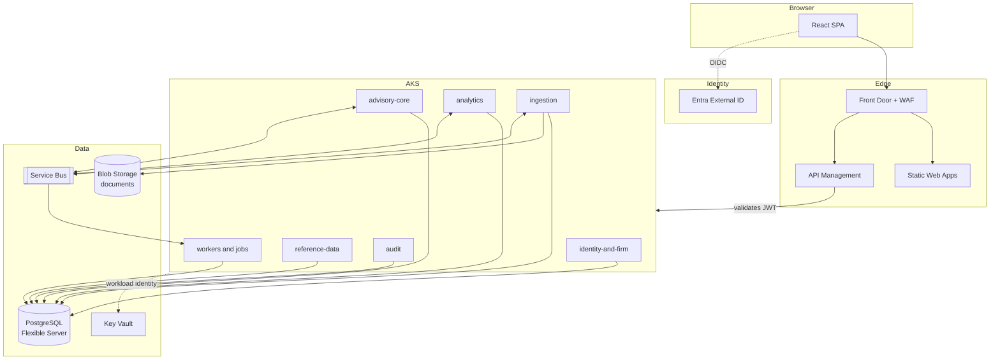

# MVP architecture (logical)

Status: **revision 1, draft for architect review**, 31 October 2026. This is the
logical and application architecture. The physical architecture — VNets,
subnets, private endpoints, node pools, sizing, Terraform module layout and the
DR runbook — is a separate document, `docs/infrastructure.md`, not yet written.

Sources: `docs/data-model.md` (revision 2, 26 Oct 2026), which this document
assumes throughout and does not restate; the delivered prototype in this
repository, which is the functional specification; the platform decisions taken
with the product owner (29–31 Oct 2026).

Every decision here is open to challenge. The section **Discussion points for
the architect** lists the ten that most need a second opinion, each with the
context, the recommendation and what specifically to confirm. Those are the
agenda for the review, not an appendix to it.

## Change log

### Revision 1 (31 October 2026)

First draft. Covers service decomposition, the calculation engine, data
architecture and tenancy, asynchronous processing, identity and authorization,
the API layer, security and compliance, observability, delivery and resilience.

Platform decisions fixed before drafting: Azure API Management; Entra External
ID as the identity provider; **schema-per-tenant** multi-tenancy; a client-facing
portal in v2 and not in this phase; a nightly drift job rather than a
continuously scaled compute tier; Java 25 LTS with Spring Boot 4.x and virtual
threads; a single region now with geo-redundant backup enabled at creation.

## Scope

**In scope for this phase**, matching the data model: customer onboarding,
customer portfolio, drift analysis against a chosen model, models, member-account
targets, planning, recommendations and audit.

**Not in this phase**: instrument research (select / retain / offload), the
client-facing portal, bulk planning across portfolios, and trade execution. The
system records decisions; it never places a trade.

**Not in this document**: physical infrastructure (see above), the Postgres DDL
(see `docs/data-model.md`, *Next*), and UI design (see
`docs/ui-ux-refinement-plan.md`).

## Architectural drivers

The data model constrains this architecture more than the technology list does.
Five of its properties drive almost every decision below.

| Property of the domain | Architectural consequence |
|---|---|
| The RIA firm is the tenant; every business row belongs to one firm | Tenancy is a structural concern, not an application filter (section 3) |
| Shared securities reference data belongs to **no** firm | A genuine ownership boundary cuts through the instrument domain: `Instrument` and `Price` are shared, `InstrumentClassification` is tenant-owned |
| Imports supersede rather than update, and rollback is a ledger replay of `ImportEffect` | Parsing and the holdings write path must sit either side of one clean transactional seam (section 1.3) |
| Derived values live in their own tables, written by a `ComputationRun` and rebuildable | A first-class compute tier, and a rule that read APIs never recalculate (section 2) |
| Approved artefacts are immutable and must reproduce what the adviser saw | Approved views are rendered from stored rows; pinning is load-bearing, not decorative |

Two further drivers come from outside the data model:

- **Regulatory.** SEBI registration, SEBI's cybersecurity and cyber-resilience
  expectations for registered intermediaries, and the DPDP Act 2023. These
  impose retention, audit, localisation and erasure obligations that conflict
  with one another (section 7.2).
- **Team.** A small team building an MVP. Every decision below prefers the
  option that is simple to operate over the option that is theoretically
  cleaner, and says so where the two differ.

## Overview

## 1. Service decomposition

### 1.1 Sizing principle

The strongest temptation in a REST microservices design is to draw service
boundaries around entities. Resist it here. A single drift calculation reads
holdings, the member-account target, the model version it pins, the firm
taxonomy, the firm's classification of each instrument, the instrument itself,
its latest price and any equivalence group it belongs to. Model publication
writes a `MemberAccountTarget` for every account on the model. Applying an import
writes holding entities, holdings, transactions, external links and
`ImportEffect` atomically, and must be reversible as a unit.

Split those along entity lines and the result is distributed transactions and
compensating sagas in an MVP that has neither the load nor the team to justify
them.

**Services are therefore drawn around lifecycle and scaling shape, not around
entities.** Six services, each with a reason to deploy, scale, secure or release
independently of the others.

### 1.2 The services

| Service | Owns | Why it is separate |
|---|---|---|
| **identity-and-firm** | `Firm`, `FirmPolicy`, `User`, `UserRole`, `AdviserPortfolioManager`, `HouseholdAdviser` | The authorization source of truth. Small, stable, read on every request by everything else. Tenant provisioning lives here. |
| **reference-data** | `Instrument`, `InstrumentType`, `InstrumentIdentifier`, `Issuer`, `Price`, the typed extensions, `InstrumentRating`, `TaxRule`, `DataSource`, `FeedRun` | **No tenancy at all.** Feed-written, read-mostly, released on the cadence of data vendors rather than of product features. |
| **advisory-core** | Households → members → member accounts → holding entities → holdings, transactions, liabilities, cash balances; taxonomy and classification; models; targets; approvals; financial plans; recommendations; `ImportEffect` | The transactional and approval heart. One consistency boundary because every write here participates in approval, audit or supersession. |
| **analytics** | `ComputationRun`, `DriftRun`, `DriftRow`, `ExposureFlag`, `PlanProjection`, `RebalanceScenario`, `SuggestedTrade` | Everything a `ComputationRun` produced and can rebuild. CPU-bound, scales independently, and is deletable without data loss. |
| **ingestion** | `Document`, `Import`, `ImportMatch`, `BankTransaction`, `TransactionCategory`, `RecurringPattern`, the parsers | Bursty, long-running, and the only service that handles raw PII documents. A distinct security posture and a distinct scaling profile. |
| **audit** | `AuditEvent` | Append-only, write-heavy, long retention, separately partitioned. Isolating it keeps retention policy away from operational tables. |

### 1.3 Two boundary decisions worth stating explicitly

**Ingestion parses and stages; advisory-core applies.** Ingestion takes a
document, parses it, resolves `ImportMatch` rows, and presents the result for
adviser review. It does not write holdings. When the adviser confirms,
`POST /imports/{id}/apply` on advisory-core performs the writes and records
`ImportEffect` in a single transaction.

This keeps the entire holdings write path — insert, supersede, and the reverse —
inside one service and one transaction. Rollback then sits next to the rows it
reverses, which is the only place it can be correct.

**advisory-core owns what is adviser-edited or approval-bearing; analytics owns
what a computation produced.** So a `Recommendation` is core: it carries an
`Approval` and a lifecycle. The `RebalanceScenario` it pins is analytics: it is
derived, rebuildable and immutable once the recommendation references it. The
boundary is the `Approval`.

A useful test when a new entity appears: *can this row be deleted and rebuilt
from master data without losing a decision anyone made?* If yes, it is analytics.

### 1.4 Modularity inside advisory-core

advisory-core is deliberately the largest service, which makes internal
discipline the thing that stops it decaying into a ball of mud.

Use **Spring Modulith**, with modules `clients`, `holdings`, `taxonomy`,
`models`, `targets`, `approvals` and `plans`. Modules communicate through
published application events and named APIs, never by reaching into one
another's internals, and **ArchUnit tests fail the build when a boundary is
crossed**. Module events are in-process today and can become Service Bus topics
later without changing the publishing code.

This is what preserves the option to split advisory-core when load or team size
demands it, without paying for the split today.

### 1.5 Synchronous call rules

- **No cyclic dependencies between services.** advisory-core calls
  reference-data and identity-and-firm; neither calls back.
- **advisory-core calls analytics** for an on-demand recalculation and waits.
  analytics never calls advisory-core synchronously; it reads what it needs and
  reports completion by event.
- **Cross-service joins are forbidden.** Where a view needs instrument detail
  across many holdings, advisory-core reads from the shared `reference` schema
  through declared read-only views rather than issuing N REST calls (section 3.2).

## 2. The calculation engine

Drift, plan projections and rebalance scenarios are the product. Everything else
is custody of the inputs and presentation of the outputs.

**Build the engine as a pure Java library with no I/O.** Inputs in — holdings,
target, model version, taxonomy, classifications, prices, policy — results out.
No repository calls, no HTTP, no clock lookups: the `as_of` date is a parameter.

Three things follow from that, and they are the reason for the constraint:

- **One home for the mathematics.** The same library serves the nightly job, the
  on-demand "recalculate this account" endpoint and the scenario builder. A
  drift figure cannot differ depending on which path produced it.
- **`ComputationRun.engine_version` becomes meaningful.** It records which
  version of a deterministic function produced a stored row, so a drift run from
  eight months ago can be explained rather than merely displayed.
- **It is testable without infrastructure**, which makes the golden-fixture
  strategy in section 9.4 possible.

**Only analytics runs the engine.** advisory-core never embeds it, even for
convenience. When a screen needs a fresh figure, core calls analytics.

### 2.1 The rule that protects the audit trail

> **Approved artefacts are rendered from stored rows. They are never
> recomputed on read.**

The data model exists to let the audit log show what the adviser saw at the
moment they approved something. A read path that recalculates — because it is
faster, or because the stored row looked stale — destroys that property
silently and without any test failing.

Concretely: an approved `MemberAccountTarget` is displayed from
`MemberAccountTargetOverride`; a `Recommendation` is displayed from its pinned
`RebalanceScenario` and `SuggestedTrade` rows; a historical `DriftRun` is
displayed from its `DriftRow` rows. Current, unapproved views may recompute
freely.

## 3. Data architecture

### 3.1 Tenancy: schema-per-tenant

**Decision: one Postgres schema per firm.** See discussion point 2 — this is a
consequential and hard-to-reverse choice, and the alternative (a shared schema
with `firm_id` and row-level security) remains open until the architect confirms.

The tenant population is structurally bounded: there are on the order of a
thousand SEBI-registered investment advisers in India in total, so the schema
count stays within what one Postgres server handles comfortably. That is what
makes this choice viable here when it would not be for a consumer product.

**Schema-per-tenant and schema-per-service multiply, so only one axis is
used.** Six services across two hundred tenants would otherwise be twelve
hundred schemas and twelve hundred migration runs per release. Service data
ownership is therefore enforced **in code**, by the rule in section 1.5 and by
ArchUnit, not by the schema boundary.

### 3.2 Schema layout

| Schema | Contents | Tenancy |
|---|---|---|
| `tenant_<firm_id>` | All firm-owned tables: households, members, member accounts, holding entities, holdings, transactions, taxonomy, classifications, models, targets, approvals, plans, recommendations, documents, imports, computation outputs, audit events | One per firm |
| `reference` | `Instrument`, `InstrumentType`, `InstrumentIdentifier`, `Issuer`, `Price`, typed extensions, `InstrumentRating`, `TaxRule`, `DataSource`, `FeedRun` | Shared; no tenancy |
| `platform` | `Firm`, `User`, `UserRole`, `AdviserPortfolioManager`, `FirmPolicy`, tenant registry, migration ledger | Shared; cross-tenant by definition |

The hybrid is unavoidable: reference data has no tenant, and the firm and user
registry must be queryable across tenants in order to resolve a login.

**`firm_id` is retained on tenant-owned rows** even though the schema already
implies it. It costs one column, it makes a row self-describing in a log or a
support query, and it leaves the door open to consolidating onto a shared schema
later without a data migration. See discussion point 10.

### 3.3 Connection handling

**One connection pool, not one per tenant.** Pool-per-tenant is the standard
mistake and stops scaling at a few dozen tenants.

Use Hibernate's schema-based multi-tenancy: a `CurrentTenantIdentifierResolver`
reads the tenant from the request context, and a `MultiTenantConnectionProvider`
issues `SET search_path TO tenant_<id>, reference` on connection checkout and
resets it on release. The reset is not optional — a leaked `search_path` is a
cross-tenant data leak.

Two guards:

- **The tenant is resolved once per request**, from the authenticated principal
  (section 5.2), and is immutable for the life of the request.
- **Integration tests assert isolation directly**: write as tenant A, assert
  tenant B cannot read it, and assert the reverse. This is the same discipline
  `CLAUDE.md` already requires of the preview `localStorage` facade, for the same
  reason — a shared substrate scoped by convention fails silently.

### 3.4 Migrations

This is the standing operational cost of schema-per-tenant, and it needs real
machinery rather than a framework default.

- **Migrations never run on pod startup.** They run as a dedicated AKS Job,
  released and observed separately from the application.
- **Flyway per schema**, driven by the tenant registry in `platform`.
- **A migration ledger** records per-tenant progress, so a run that fails at
  tenant 143 of 200 is resumable rather than mysterious.
- **Every application release must tolerate schema versions N and N-1
  coexisting**, because during a migration run some tenants are on each. In
  practice: additive changes only, expand-then-contract over two releases, and
  no release that requires a column it has just added.
- `reference` and `platform` migrate once, before the tenant fan-out.

### 3.5 Encryption of personal data

`docs/data-model.md` requires PAN, dates of birth and account numbers to be
encrypted at rest and masked in the API. Two refinements it does not yet cover:

**Encrypt in the application, not in the database.** Envelope encryption with
keys in Key Vault, accessed through AKS workload identity. If encryption happens
inside Postgres, the database holds the key material and the backup holds both,
which defeats most of the purpose.

**PAN needs a blind index.** The data model asks for PAN to be encrypted *and*
to carry a uniqueness constraint. Those are mutually exclusive: properly
encrypted ciphertext is non-deterministic, so it can neither be constrained
unique nor looked up. Resolve it with a keyed HMAC column:

| Column | Purpose |
|---|---|
| `pan_encrypted` | The value, envelope-encrypted, decryptable only by the service |
| `pan_hmac` | `HMAC-SHA256(pan, key)` — carries the unique constraint and serves lookups |
| `pan_last4` | Stored in clear for display |

The HMAC key is separate from the encryption key and never rotates without a
planned rebuild. See discussion point 8.

### 3.6 Partitioning and retention

Four tables grow without bound and need a partitioning and retention decision
before the DDL, not after:

| Table | Growth driver | Approach |
|---|---|---|
| `Price` | instruments × trading days | Range partition by `price_date` |
| `BankTransaction` | onboarding working data | Range partition by `posted_date`; retention policy outstanding (data model, open item 7) |
| `AuditEvent` | every business action | Range partition by `occurred_at`; retention set by SEBI record-keeping, not by convenience |
| `DriftRow` | **member accounts × taxonomy nodes × nights** | The largest by some distance, and the subject of discussion point 4 |

`DriftRow` deserves the attention. A nightly run storing every row for every
member account produces, at fifty thousand accounts and a hundred taxonomy
nodes, five million rows a night and close to two billion a year — for data that
is by definition rebuildable. Options are retention (keep nightly rows for
ninety days, keep indefinitely only runs an adviser acted on), or storing only
the `DriftRun` summary nightly and materialising `DriftRow` on demand. The
decision needs the volumes in discussion point 4.

## 4. Asynchronous processing

Azure Service Bus for messaging; AKS for the workers and scheduled jobs; KEDA to
scale workers on queue depth.

### 4.1 Four things that are not automatic

**Transactional outbox.** Writing to Postgres and publishing to Service Bus is a
dual write, and without an outbox the system will lose events — a holding
applied with no drift recomputation, a model published with half its accounts
rolled forward. Write the message to an `outbox` table in the same transaction
as the business change; a relay publishes and marks it sent.

**Idempotent consumers.** Service Bus delivers at least once, so every consumer
must tolerate redelivery. Each writes a `processed_message` row keyed by message
id in the same transaction as its effect. The data model already helps here:
`dedupe_hash` on transactions, `import_id` on everything an import wrote.

**Dead letters need an owner.** A failed import that dead-letters silently is a
client whose portfolio is quietly wrong. DLQ depth is an alerting metric, and
failed imports appear in an operations screen with the parser error attached.

**Long jobs need lock renewal.** Parsing a large CAS can exceed the message lock
duration. Either renew the lock while working, or move to a claim-check pattern
where the message carries a document reference and the worker tracks its own
state in `Import.status`.

### 4.2 Principal flows

| Trigger | Flow |
|---|---|
| Adviser uploads a statement | `document.uploaded` → parse job → `ImportMatch` rows → `Import(review)` → adviser confirms in the UI → `import.apply.requested` → advisory-core applies transactionally and writes `ImportEffect` → `holdings.changed` → drift recompute for the affected member accounts |
| Nightly | `CronJob` enumerates member accounts per tenant and enqueues one `drift.compute` message each; KEDA-scaled analytics workers consume them |
| Model published | Rollout saga: one `rollout.account` message per member account on the model. `ModelVersionRollout` rows **are** the state machine; the model version remains `publishing` until every row is terminal, then becomes `published` |
| Financial plan edited | `plan.changed` → `PlanProjection` rebuild |
| Price feed received | reference-data ingests → `prices.updated`. **No per-tick fan-out**: revaluation and drift happen in the nightly run, or on demand when an adviser opens an account |
| Classification change set applied | `classification.applied` → affected accounts queued for recompute. Per the data model, this changes what the next run sees and never rewrites an approved target or a stored run |

### 4.3 Job shapes

Three distinct shapes, and conflating them causes most scheduled-job pain:

- **Scheduled fan-out** (nightly drift): a `CronJob` whose only work is
  enumerating subjects and enqueuing one message each. It does no computation,
  so it finishes in seconds and cannot partially fail in an interesting way.
- **Queue-driven workers** (drift compute, projections, rollout): long-lived
  deployments scaled by KEDA on queue depth. This is where the work happens, and
  scaling it is a replica count rather than a redesign.
- **Per-item jobs** (document parsing): an AKS Job per document where the work
  is heavy, isolated and benefits from a clean process.

The nightly drift requirement is satisfied by the first two together, and the
scaling lever is a number in a Helm value.

## 5. Identity and authorization

### 5.1 Authentication

**Microsoft Entra External ID**, OAuth 2.0 / OIDC, authorization code flow with
PKCE from the React SPA. No passwords, sessions or credential storage in this
system. See discussion point 1: "external IdP" is a principle rather than a
product, and the specific fit of Entra External ID for *B2B organisations* needs
confirming before it is locked in.

Tokens are short-lived access tokens held in memory in the SPA, refreshed
through the IdP. They are not written to `localStorage`, which is readable by any
script on the origin.

### 5.2 The rule that keeps the IdP replaceable

> **The identity provider proves who you are. The database decides what you can
> do and for which firm.**

The OIDC `sub` claim maps to `User.auth_subject` — already in the data model.
Everything else is resolved from `platform` on each request: the firm, the roles,
the `can_approve` flag, the household assignments.

This is not purism. Firm membership and authorization in IdP claims means that
replacing the IdP is a data migration and that an authorization change requires
a directory write and a token refresh before it takes effect. Resolved from the
database, replacing the IdP is a configuration change and a revoked permission
is effective on the next request.

### 5.3 Three layers of authorization

Role-based access control alone cannot express this domain, and discovering that
late is expensive.

| Layer | Question | Source |
|---|---|---|
| **Authentication** | Is this a valid, unexpired token from our IdP? | APIM, then re-validated in every service |
| **Role** | May an `operations` user publish a model? | `UserRole` |
| **Relationship** | May *this* adviser see *this* household? | `HouseholdAdviser`, `AdviserPortfolioManager` |
| **Policy** | May this user approve this target? | `User.can_approve`, plus `Approval.policy`; under a future `maker_checker`, `decided_by ≠ requested_by` |

The relationship layer is the one that cannot live in a token: it depends on
link tables that change daily and would make tokens both enormous and stale.
Implement it as a policy component in advisory-core that resolves the
principal's household scope per request, backed by a short-lived cache of the
link tables with explicit invalidation on change.

Design the interface as *"which households may this principal see?"* rather than
*"which households does this adviser own?"*. A v2 portal client is then a
principal scoped to one household rather than a special case threaded through
every query.

### 5.4 Non-human actors

Jobs, workers and feeds act without a user. The data model anticipates this:
`AuditEvent.actor_kind` is `user`, `system`, `import` or `feed`.

Each worker authenticates with its own workload identity and carries an explicit
system principal into the audit trail. A nightly drift run is attributed to
`system`, not to whichever adviser last logged in. Workers resolve tenant
context from the message, never from an ambient default.

## 6. API layer

### 6.1 API Management

Azure APIM terminates the public API. Its responsibilities are deliberately
narrow: JWT validation, rate limiting and quotas, request logging with PII
redaction, API versioning and the developer-facing surface.

**APIM is not a trust boundary and holds no business logic.** Every service
validates the token itself; a call that reaches a pod by any other route is
still refused. Transformation, orchestration and authorization stay in the
services, where they are testable.

**Two products from the start**: `staff-api` now, `client-api` in v2. Separate
policies, separate rate limits, separate credentials. Costs nothing today and
stops the v2 portal being bolted onto the adviser API.

### 6.2 API conventions

- REST over JSON. Resource-oriented paths following the data model's hierarchy:
  `/households/{id}/member-accounts/{id}/drift-runs/{id}`.
- **Versioned in the path** (`/v1/...`) from the first release.
- **Money and percentages cross the wire in the data model's units** —
  percentage points as decimals, amounts as strings to avoid floating-point
  drift in JavaScript. The SPA formats lakh and crore; the API never does.
- **Nulls are meaningful and are preserved.** A null `target_pct` means "below
  the model's depth, not specified" and is distinct from zero. A null ISIN means
  no source supplies one. The API never substitutes a placeholder — the same
  principle the prototype already follows.
- **Idempotency keys** on all non-GET endpoints that create or approve.
- Long-running operations return `202` with a status resource rather than
  holding the connection.

### 6.3 Front end

React SPA on Azure Static Web Apps, behind Front Door with WAF.

- **Do not use the Static Web Apps built-in authentication.** Authentication is
  Entra External ID through the application's own OIDC flow.
- Static Web Apps does not provide Azure WAF, which is the reason Front Door
  Premium sits in front rather than serving traffic directly.
- Strict `Content-Security-Policy`, `Strict-Transport-Security` and
  `X-Content-Type-Options` headers, with CSP tight enough to make token theft
  from a script injection impractical.

## 7. Security and compliance

### 7.1 Documents

The one place raw client PII sits outside the database.

- Azure Blob Storage, private endpoint, no public access, customer-managed keys.
- Access through short-lived user-delegation SAS tokens scoped to a single blob,
  never an account key.
- Malware scanning enabled before a document is made readable.
- `Document.sha256` is unique per firm, so the same statement uploaded twice is
  recognised rather than double-imported.
- Immutable storage policy for the regulatory retention period.
- NSDL and CDSL CAS files are password-protected with a PAN and date-of-birth
  derivation. That password is a credential: it is never stored alongside the
  document, and ideally it is used transiently at parse time and discarded.

### 7.2 Three obligations that conflict

This needs a decision from compliance, and it has to be designed in rather than
retrofitted.

| Obligation | Requires |
|---|---|
| DPDP Act 2023 | Erasure of personal data on request |
| Audit trail | `AuditEvent` is append-only and never modified |
| SEBI record-keeping | Records retained for a defined multi-year period |

A data principal asking for erasure of records the firm is legally obliged to
retain cannot be satisfied by deletion.

**Recommended approach: crypto-shredding.** Personal data is encrypted with a
per-data-subject key; erasure destroys the key, leaving the structure, the audit
trail and the aggregate record intact while the personal content becomes
permanently unrecoverable. This only works if the key hierarchy is designed in
from the first release — retrofitting it means re-encrypting everything. See
discussion point 9.

Statutory retention is generally a lawful basis for refusing erasure, so the
legal position may be simpler than the technical one. The point is that the
decision must be taken deliberately and recorded, not discovered when the first
request arrives.

### 7.3 Residency and platform security

- **All data in India.** Central India primary, with South India as its paired
  region for geo-redundant backup.
- Secrets in Key Vault, reached by AKS workload identity. **No secrets in
  GitHub, in container images or in environment variables.**
- Private endpoints for Postgres, Blob Storage, Key Vault and Service Bus;
  Service Bus Premium is required for private endpoints and is also what makes
  geo-disaster-recovery pairing available later (section 10).
- Non-production environments never contain real client data. Synthetic data
  only, seeded from the prototype's `data/*.json`.
- Container image scanning in the pipeline, and a documented VAPT cadence —
  SEBI's cyber-resilience expectations for registered intermediaries make this a
  compliance artefact, not only good practice.

## 8. Observability

Not on the original technology list, and the cheapest thing to add now.

- **OpenTelemetry** from the Java services to Azure Monitor and Application
  Insights. Traces, metrics and logs with one correlation identifier.
- **That identifier is `AuditEvent.request_id`**, already in the data model.
  Carry it from the SPA through APIM, through every service and onto every
  message, so a support question — *why does this client's drift look wrong?* —
  is one query across the API call, the computation run and the audit entry.
- **Structured JSON logs with PII redaction at the logging layer**, not by
  convention. A PAN in Application Insights is a reportable incident.
- **Business-level alerts, not only infrastructure ones.** Imports stuck in
  `review` beyond a threshold; drift runs failing or not completing before the
  business day; dead-letter queue depth; a model rollout with rows stuck
  non-terminal; feed runs that did not arrive.
- Per-tenant dimensions on metrics so a single firm's problem is visible rather
  than averaged away.

## 9. Delivery

### 9.1 Repositories

One repository per service plus one for infrastructure, or a monorepo with
per-service pipelines. For a team this size the **monorepo** is recommended:
shared contract definitions and the engine library stay in step, and a change
spanning two services is one pull request and one review.

This prototype repository stays separate. It is the functional specification and
the source of test fixtures, not part of the product build.

### 9.2 CI/CD

GitHub Actions throughout.

- **Authenticate to Azure by OIDC federation**, not stored service-principal
  secrets. GitHub mints a short-lived token per run; there is no long-lived
  credential to leak or rotate.
- Build → unit tests → contract tests → container build and scan → push to
  Azure Container Registry → Helm deploy.
- Terraform plan on pull request, apply on merge, with state in Azure Storage,
  state locking enabled, and **separate state per environment**.
- Environment protection rules requiring approval for production.

### 9.3 Database migrations in the pipeline

Called out separately because schema-per-tenant makes it a first-class concern
(section 3.4). Migrations are a distinct pipeline stage running as an AKS Job
against the tenant registry, with a resumable ledger, run **before** the
application deployment that depends on them, and gated on every tenant
reaching the target version.

### 9.4 Testing

| Level | Approach |
|---|---|
| Engine | **Golden fixtures taken from this prototype.** `data/*.json` plus the existing JavaScript calculations are a working reference implementation. Capture their outputs and the Java engine has an exact conformance suite from day one — the single highest-value testing decision available here |
| Unit | Standard, with the engine fully covered because it has no I/O to mock |
| Contract | Consumer-driven contract tests between services, so advisory-core and reference-data cannot drift apart silently |
| Tenancy | Explicit isolation tests (section 3.3). Write as A, assert B cannot read, assert the reverse |
| Integration | Testcontainers with real Postgres. Schema-per-tenant behaviour cannot be verified against an in-memory database |
| Migration | Every migration tested forward against a populated multi-tenant database, and tested for N / N-1 coexistence |

### 9.5 Environments

`dev` → `uat` → `prod`, all in India, all built by the same Terraform modules
with region and sizing as variables. UAT holds synthetic data only.

## 10. Resilience and disaster recovery

A single region now, **active-passive multi-region kept available** without
being built. Active-active is not proposed: for a single-country regulated
advisory platform it buys complexity that will not be used.

Three choices are made at resource creation and are painful or impossible to
reverse, which is why they are taken now:

| Choice | Why now |
|---|---|
| **Postgres geo-redundant backup, enabled at server creation** | On Azure Database for PostgreSQL Flexible Server this has not been switchable afterwards — recovering the option means creating a new server and migrating. Verify against current Azure documentation; plan as though it holds. See discussion point 3 |
| **Blob Storage GRS/RA-GRS at account creation** | Some replication conversions are restricted after the fact |
| **Service Bus Premium rather than Standard** | Geo-disaster-recovery pairing is Premium-only, and Premium is already required for private endpoints |

Everything else is deferred cheaply by keeping services stateless with no local
disk assumptions, parameterising region in Terraform from the first commit with
state per environment and region, and using UUID keys — which the data model
already specifies — so there are no cross-region sequence collisions. Front Door
is already global, so adding an origin is configuration.

RPO and RTO targets are not yet set and belong in `docs/infrastructure.md`
alongside the DR runbook.

## 11. Technology summary

| Concern | Choice | Note |
|---|---|---|
| Backend language | **Java 25 LTS** | Current LTS. JEP 491 (Java 24) removed virtual-thread pinning on `synchronized` blocks, which materially changes whether virtual threads deliver |
| Framework | **Spring Boot 4.x**, current GA | Confirm the exact version at kickoff |
| Concurrency | **Virtual threads enabled** (`spring.threads.virtual.enabled=true`) | Ordinary blocking code with the scalability previously needing reactive programming. The services are I/O-bound, which is exactly the case virtual threads address, and the team does not have to learn Project Reactor. Caveats: they do not help CPU-bound work — the engine scales with replicas — and they move the bottleneck to the connection pool, so pool sizing and semaphore-based admission control matter more, not less |
| Front end | React on **Azure Static Web Apps** | Behind Front Door Premium with WAF |
| API gateway | **Azure API Management** | Edge authentication, throttling, versioning |
| Identity | **Entra External ID**, OAuth 2.0 / OIDC | Discussion point 1 |
| Database | **Azure Database for PostgreSQL Flexible Server** | Schema per tenant; geo-redundant backup at creation |
| Messaging | **Azure Service Bus Premium** | Private endpoints and geo-DR optionality |
| Compute | **AKS** with KEDA | Deployments for workers, Jobs for per-item and migration work, CronJob for the nightly fan-out |
| Documents | **Azure Blob Storage** | Private endpoint, customer-managed keys, malware scanning |
| Secrets | **Key Vault** with AKS workload identity | No secrets in images or pipelines |
| Observability | **OpenTelemetry → Azure Monitor / App Insights** | `request_id` as the correlation identifier |
| SCM and CI/CD | **GitHub, GitHub Actions** | Azure access by OIDC federation |
| IaC | **Terraform** | State in Azure Storage, per environment and region |
| Migrations | **Flyway**, orchestrated per tenant | Section 3.4 |

## Decisions taken

- **Services are sized by lifecycle and scaling shape, not by entity.** Six
  services; advisory-core is deliberately the largest and is kept disciplined by
  Spring Modulith and ArchUnit rather than by being split.
- **Ingestion parses and stages; advisory-core applies.** The holdings write
  path and its reversal stay in one service and one transaction.
- **advisory-core owns what is approval-bearing; analytics owns what a
  computation produced and can rebuild.** The `Approval` is the boundary.
- **The calculation engine is a pure library with no I/O**, run only by
  analytics, serving both the nightly job and on-demand recalculation.
- **Approved artefacts are rendered from stored rows, never recomputed.**
- **Schema per tenant**, with shared `reference` and `platform` schemas. Only
  one schema axis is used; service ownership is enforced in code.
- **`firm_id` is retained** on tenant-owned rows despite the schema boundary.
- **The identity provider proves identity only.** Firm, roles and permissions
  resolve from the database on every request.
- **Authorization has a relationship layer** that cannot live in a token, and is
  designed as "which households may this principal see?" so a v2 portal client
  is not a special case.
- **PAN uses a blind index** — encrypted value plus keyed HMAC — because
  encryption and a uniqueness constraint are otherwise mutually exclusive.
- **Transactional outbox and idempotent consumers** are mandatory, not optional
  hardening.
- **No per-tick drift fan-out on price updates.** Nightly, or on demand.
- **Geo-redundant backup, GRS storage and Service Bus Premium are chosen at
  creation**, so a second region stays available later.
- **The prototype's data and calculations become golden test fixtures** for the
  Java engine.

## Discussion points for the architect

The ten items below are the agenda for architecture review. Each states what was
assumed in order to make progress and what specifically needs confirming.

### 1. Identity provider: is Entra External ID the right fit?

**Context.** "OAuth 2 / OIDC with an external IdP" is a principle — federate,
do not build authentication — rather than a product choice. Entra External ID is
one candidate alongside Entra ID with B2B guests, Auth0 or Okta, and
self-hosted Keycloak.

**Recommendation.** Entra External ID, for stack coherence, a single vendor and
the same India residency story as everything else.

**To confirm.** Entra External ID grew out of Azure AD B2C, which was
consumer-first. The specific capability to verify is **B2B organisation
modelling**: a user belonging to firm X, the firm available as a token claim,
per-firm branding, and federation to an RIA firm's own Microsoft or Google
tenant. Auth0's *Organizations* concept is the benchmark to measure it against.
Also confirm the plan for the v2 client portal — separate directory, or separate
user flows in the same one. The rule in section 5.2 limits the damage of getting
this wrong, but it does not eliminate it.

### 2. Tenancy: schema-per-tenant or shared schema with row-level security?

**Context.** This document assumes schema-per-tenant. `docs/data-model.md`
assumes the alternative — `firm_id` on every row with row-level security — so
one of the two documents must change. The tenant population is bounded at the
order of a thousand SEBI-registered advisers, which is what makes
schema-per-tenant viable here.

| | Schema-per-tenant | Shared schema + RLS |
|---|---|---|
| Isolation demonstrable to an auditor | Strong and structural | Policy-based; correct but harder to explain |
| Restore one firm | `pg_restore -n tenant_x` | Point-in-time restore to a side server, then extract |
| Offboarding / export | `pg_dump -n tenant_x` | Query and serialise |
| **Migration cost per release** | **N schemas, every release, forever; partial failure leaves mixed versions the application must tolerate** | One run |
| Cross-tenant operational queries | `UNION ALL` over N schemas, or a warehouse | Ordinary query |
| Leak from a missing predicate | Structurally impossible | RLS catches it, if the policy is right |

**Recommendation.** Both are defensible at this tenant count. Row-level security
would be the lighter choice, because the migration tax is permanent and
compounds with every release while the per-tenant restore benefit is needed a
few times a year. Schema-per-tenant is assumed here as instructed.

**To confirm.** Which model, and therefore whether section 3 of this document or
the tenancy convention in `docs/data-model.md` gets rewritten. If
schema-per-tenant stands, confirm the migration machinery in section 3.4 is
considered adequate, because it is the whole cost of the decision.

### 3. Enable geo-redundant backup at server creation?

**Context.** Only one region is planned. On Azure Database for PostgreSQL
Flexible Server, geo-redundant backup has historically had to be **chosen when
the server is created**, and could not be enabled afterwards; recovering the
option later meant standing up a new server and migrating onto it. Azure
changes, so verify this against current documentation — but plan as though it
still holds, because the downside is asymmetric. Without geo-redundancy, a
region-level failure or an accidental server deletion has no out-of-region
recovery path whatsoever.

**Recommendation.** Enable it. Backup storage up to the provisioned storage size
is included at no charge; geo-redundancy is billed on backup storage consumed
beyond that allowance and costs roughly double the single-region rate for the
same volume. At MVP data volumes that is a minor line item against an
irreversible architectural option — the cheapest insurance in the design. The
same reasoning applies to GRS on the storage account and to Service Bus Premium,
which is in any case required for private endpoints.

**To confirm.** Agreement to enable, and the actual figure from the Azure pricing
calculator for Central India against the projected database size from discussion
point 4. Also confirm South India as the paired region is acceptable for
residency.

### 4. Capacity: what volumes must the nightly drift run and its stored output absorb?

**Context.** A nightly drift job is the agreed approach, and the design in
section 4.3 scales from small to large by changing a replica count rather than
by being redesigned. So the *compute* is unlikely to be the constraint. The
**storage** very likely is, and that decision has to be taken before the DDL.

Drift is computed per member account and stored as one `DriftRun` plus one
`DriftRow` per taxonomy node. Because prices move daily, every account's drift
genuinely changes every day, so a nightly run cannot be limited to accounts
whose holdings changed. At fifty thousand member accounts and a hundred taxonomy
nodes, that is five million rows a night and close to two billion within a year
— for data that is by definition rebuildable from master records.

**The question to resolve.** Volumes, and then the retention decision that
follows from them:

1. How many RIA firms (tenants) at 12 months, and at 36?
2. Member accounts per firm — median, and the largest firm you expect to serve?
3. Holdings per member account — typical, and worst case?
4. How deep will the firm taxonomy go in practice, and roughly how many nodes
   does that produce? This is the direct multiplier on `DriftRow`.
5. How many documents will be uploaded per firm per month, and what is the
   largest single statement to parse?
6. How many instruments will reference data carry, and will prices be stored
   daily for all of them or only for held instruments?
7. How many advisers will be working concurrently at peak?
8. **How long must a nightly drift run be retained?** The options are: keep all
   nightly rows for a fixed window such as ninety days and keep indefinitely
   only the runs an adviser acted on; or store only the `DriftRun` summary
   nightly and materialise `DriftRow` on demand. Either is sound. Choosing
   neither, and keeping everything forever, is the expensive default.
9. Is there a regulatory requirement to reproduce a drift position for any past
   date, or only for dates on which the adviser took a recorded action? The
   answer to this decides question 8.

**What the answers change.** Questions 1–4 size the nightly window and the
worker replica count. Questions 8 and 9 determine the `DriftRow` partitioning
and retention policy, which is a schema decision and therefore has to be settled
before the DDL rather than after.

### 5. Is six coarse services the right decomposition?

**Context.** Section 1.1 argues against entity-shaped microservices for this
domain, because drift, model publication and import application each span what
would otherwise be several services. advisory-core is deliberately large.

**Recommendation.** Six services, with Spring Modulith and ArchUnit maintaining
the internal seams so advisory-core can be split later without a rewrite.

**To confirm.** Whether the architect accepts a deliberately large core service,
and whether the ingestion / advisory-core seam in section 1.3 — parse and stage
on one side, apply and record `ImportEffect` on the other — is the right place
to cut.

### 6. Statement parsing: which language, build or buy?

**Context.** This is the largest technical risk in the programme and it is not
addressed by any decision taken so far. NSDL and CDSL CAS files are
password-protected PDFs; broker and bank statement layouts vary by institution
and change without notice; the mature tooling for PDF extraction is in the
Python ecosystem rather than the Java one.

**Options.** A polyglot Python parsing service, isolated behind the ingestion
API; Java with PDFBox and hand-written per-institution extractors; or a
commercial Indian statement-parsing vendor.

**Recommendation.** Run a spike before the architecture is frozen. If it
confirms the tooling gap, a Python parser service is the one place where
departing from "Java for backend" is likely to pay for itself — the boundary is
already clean, since ingestion neither writes holdings nor shares a transaction
with anything.

**To confirm.** Appetite for a polyglot service at all, and whether buying is on
the table.

### 7. Account Aggregator as an ingestion channel

**Context.** For Indian bank data, the RBI Account Aggregator framework is the
consent-based regulated channel, and is materially better than asking clients to
upload bank statement PDFs. The data model currently anticipates manual upload
now and Gmail ingestion later.

**The architectural consequence is small but must be taken now.** Account
Aggregator delivers **structured JSON under a consent artefact, not a
document**. So `Import.document_id` must be nullable and `Document` must not be
a required step in the import pipeline. That is a one-line change to the data
model today and an invasive one once parsers, reviews and rollback all assume a
document exists. A consent artefact entity will also be needed.

**To confirm.** Whether Account Aggregator is a planned channel, and whether to
make `Import.document_id` nullable now regardless.

### 8. PAN: encrypted and unique at the same time

**Context.** `docs/data-model.md` requires PAN to be encrypted at rest and to
carry a uniqueness constraint. Properly encrypted ciphertext is
non-deterministic, so it can be neither constrained unique nor looked up. The
two requirements as written are mutually exclusive.

**Recommendation.** The blind-index pattern in section 3.5 — `pan_encrypted`
plus `pan_hmac` carrying the constraint plus `pan_last4` for display, with the
HMAC key separate from the encryption key.

**To confirm.** Acceptance of the pattern, and whether the same treatment is
needed for any other searchable encrypted field such as folio or demat account
numbers.

### 9. DPDP erasure against append-only audit and SEBI retention

**Context.** Section 7.2. Three obligations that cannot all be satisfied by
deletion.

**Recommendation.** Crypto-shredding, with per-data-subject keys, designed into
the key hierarchy from the first release because retrofitting it means
re-encrypting everything. The legal position may well be simpler than the
technical one — statutory retention is generally a lawful basis for declining
erasure — but the decision should be taken deliberately and recorded.

**To confirm.** Compliance input on whether crypto-shredding is required at all,
before the encryption design is fixed.

### 10. Does `firm_id` stay on every row under schema-per-tenant?

**Context.** With a schema per tenant the column is redundant. It costs one
column, makes a row self-describing in logs and support queries, and preserves
the option of consolidating onto a shared schema later without a data migration.

**Recommendation.** Keep it.

**To confirm.** Agreement, and then an update to `docs/data-model.md` so that its
tenancy convention and this document stop contradicting each other, whichever
way discussion point 2 lands.

## Open items

Distinct from the discussion points above: these are unresolved but not blocking,
and will be settled as the work proceeds.

1. **RPO and RTO targets**, and the DR runbook — with `docs/infrastructure.md`.
2. **Retention periods** for `BankTransaction`, `Document` and `AuditEvent` —
   inherited from the data model's open item 7, now also a partitioning input.
3. **Caching strategy.** Likely Redis for the authorization link tables and
   reference data. Deliberately deferred: in a multi-tenant system a cache is a
   cross-tenant leak waiting to happen, so it needs designing rather than
   adding.
4. **Notification channel** for the `communicated` recommendation state —
   probably Azure Communication Services. Not yet in the data model.
5. **Client-facing PDF report generation.** Advisers will need it; no entity
   models it yet.
6. **Search.** Postgres full-text search is sufficient for households and
   instruments at this scale. Revisit only if it demonstrably is not.
7. **Feature flag mechanism**, needed before the first parallel-release work.
8. **`schema_version` on every `jsonb` column** — `PlanProjection.yearly_rows`,
   `PlanProjection.assumptions`, `RebalanceScenario.constraints`,
   `AuditEvent.before`/`after`. The production analogue of this repository's
   storage-key rule: when the shape changes, version it rather than
   reinterpreting old payloads.
9. **Rate limits and quotas** per firm, to be set in APIM once usage is known.

## Next

1. Architect review against the ten discussion points.
2. Reconcile `docs/data-model.md` with whatever discussion points 2, 7 and 10
   decide.
3. Spike the statement parser (discussion point 6) and the Entra External ID
   organisation model (discussion point 1).
4. Postgres DDL under `schema/`, with the tenant schema template, partitioning
   and the seed tables.
5. `docs/infrastructure.md`: network topology, sizing, Terraform module layout,
   environments and the DR runbook.
6. Extract golden fixtures from the prototype for the engine conformance suite.
