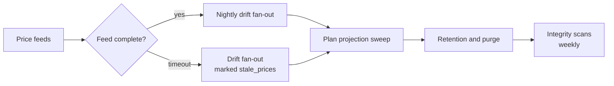

# Batch job architecture and design

Status: **revision 1, draft for review**, 31 October 2026.

Builds on `docs/architecture.md` section 4 (asynchronous processing) and
`docs/microservices-design.md` section 4 (the event catalogue). This document is
the design of the scheduled and queue-driven work: what runs, when, over what
scope, what happens when it fails, and how anyone knows.

Batch work in this system is not a side concern. The nightly drift run is what
makes the portfolio overview meaningful when an adviser opens it in the morning,
and the model rollout is the only path by which a published model reaches a
client's target. If the batch tier is unreliable, the product is wrong rather
than slow.

## 1. Principles

**Scheduled jobs enumerate; workers compute.** A `CronJob` that does the work
itself is a single point of failure with no partial recovery. A `CronJob` that
enqueues one message per subject finishes in seconds, and the work becomes
independently retryable, parallelisable and observable.

**Everything is idempotent on a key.** Service Bus delivers at least once. Every
consumer writes a `processed_message` row keyed by `event_id` in the same
transaction as its effect. Re-delivery is a no-op, not a duplicate.

**Everything is resumable per tenant.** Under schema-per-tenant, a nightly run
is N runs. Tenant 143 failing must not stop tenant 144, and a rerun must not
redo tenants 1 to 142.

**Derived output is rebuilt, never patched.** A drift run is written whole or
not at all. There is no code path that adjusts yesterday's `DriftRow`.

**Nothing silently skips.** A tenant skipped because a migration was in
progress, a member account skipped because it had no approved target — each is
recorded with a reason and counted in the run summary. A job that reports
success while having done half the work is worse than one that fails.

## 2. The tenant fan-out problem

This is the structural consequence of schema-per-tenant on batch work, and the
thing most likely to be got wrong.

Every scheduled job iterates the tenant registry in `platform`, and for each
tenant sets `search_path` before doing anything. That creates four requirements
no single-tenant design has:

| Requirement | Design |
|---|---|
| A tenant mid-migration must be skipped, not half-processed | The scheduler reads the migration ledger and skips tenants not at the target schema version, recording them as `skipped_migrating` |
| One tenant's failure must not affect another | Each tenant is a separate message and a separate transaction. There is no shared cursor |
| A rerun must not repeat completed tenants | Each `(job, as_of, tenant)` has a run-ledger row. A rerun processes only tenants without a terminal row |
| A large tenant must not starve small ones | Messages are enqueued tenant-interleaved by member account, not tenant-by-tenant in sequence, so one firm with 20,000 accounts cannot hold up a firm with 50 |

The last point is worth stating plainly: **enqueue by subject, interleaved, not
grouped by tenant.** Grouping by tenant is the obvious implementation and it
makes the smallest customer's results arrive last.

## 3. Job taxonomy

| Shape | When to use | Kubernetes object | Failure unit |
|---|---|---|---|
| **Scheduled fan-out** | Nightly recomputation, retention, integrity scans | `CronJob` | The enumeration, which is cheap to retry |
| **Queue worker** | Per-subject computation | `Deployment` + KEDA | One message |
| **Per-item job** | Heavy, isolated work needing a clean process | `Job` per item | One item |
| **Saga** | Multi-step work with per-step state that must be auditable | `Deployment` + a state table | One step |
| **Pipeline job** | Migrations, provisioning | `Job`, run by CI/CD | The whole run, resumable |

## 4. Job catalogue

### 4.1 Nightly drift recomputation

The principal batch workload.

| | |
|---|---|
| **Trigger** | `CronJob`, nightly after market close and price feed completion |
| **Shape** | Scheduled fan-out → queue workers |
| **Scope** | Every member account with an approved target, in every tenant at the target schema version |
| **Enqueues** | One `drift.compute` per member account, tenant-interleaved |
| **Writes** | `ComputationRun`, `DriftRun`, `DriftRow`, `ExposureFlag` |
| **Idempotency** | `(member_account_id, as_of)`. A re-delivered message finds the run present and returns |
| **Depends on** | `prices.updated` for the business date. The scheduler waits for the feed or proceeds with the last available prices and marks the run `stale_prices` |
| **Features** | OV-04, OV-06, OV-08, XC-07 |

**Why every account, every night.** Prices move daily, so every account's drift
genuinely changes daily. There is no subset-of-changed-accounts optimisation
available; limiting the run to accounts whose holdings changed would leave the
overview wrong for everyone else.

**The window budget.** At roughly 100ms per account — read holdings, classify,
roll up the tree, write rows:

| Member accounts | Single worker | 10 workers | 25 workers |
|---|---|---|---|
| 5,000 | 8 min | < 1 min | < 1 min |
| 50,000 | 83 min | 8 min | 3 min |
| 200,000 | 5.5 hr | 33 min | 13 min |

The compute is comfortable at every realistic scale, and the scaling lever is a
replica count. **Storage is the constraint, not time** — see section 4.7 and
architecture discussion point 4.

**Overlap guard.** The scheduler refuses to start if the previous night's run
has incomplete tenants, and alerts instead. Two concurrent nightly runs writing
the same `(account, as_of)` is the one race this design does not tolerate.

### 4.2 Model publication rollout

A saga, because it spans many accounts and every step must be auditable.

| | |
|---|---|
| **Trigger** | `model.published` |
| **Shape** | Saga with `ModelVersionRollout` as the state table |
| **Scope** | Every member account whose approved target pins the previous model version |
| **Writes** | One new `MemberAccountTarget` per account; `ModelVersionRollout` per account |
| **Idempotency** | `(model_version_id, member_account_id)`, which is the rollout row's natural key |
| **Features** | MD-12, MD-13, MD-14 |

**The rollout rows are the state machine.** The model version stays `publishing`
until every rollout row reaches a terminal state, then becomes `published`. This
is deliberate: the rollout's progress is queryable, auditable and resumable
because it is data, not in-memory orchestration.

Per account, by `customisation_policy`:

- `preserve` — overrides carried where the node still exists, dropped with a
  reason where it does not; the new target auto-approved under
  `Approval.policy = model_publication`.
- `reset` — overrides dropped; the new target created as `draft` so the adviser
  sees the customisations go before approving.

**No compensation path.** A partially completed rollout is not rolled back; it
is resumed. The previous target is `superseded`, never altered, so the system is
always in a consistent state even mid-rollout — some accounts on the new
version, some on the old, every one of them valid.

### 4.3 Import processing

| | |
|---|---|
| **Trigger** | `document.uploaded` |
| **Shape** | Per-item `Job` — heavy, isolated, variable duration |
| **Writes** | `Import`, `ImportMatch`; nothing in `advisory-core` |
| **Idempotency** | `(document_id, parser_version)` |
| **Features** | IN-02..IN-08, IN-13 |

Parsing ends at `Import(review)`. **A human decides whether it becomes data**,
and the apply is a separate, synchronous, transactional call into
`advisory-core` (IN-09). Nothing in this job writes a holding.

**Long parses need lock management.** A large CAS can exceed the Service Bus
lock duration; the job renews its lock while working, and tracks its own
progress in `Import.status` so a lost lock is recoverable rather than a silent
restart.

**Failure is visible, not dead-lettered.** `Import` moves to `failed` with the
parser error attached and appears in the operations queue (IN-17). A statement
that silently vanished is a client whose portfolio is quietly wrong.

### 4.4 Price and instrument feed ingestion

| | |
|---|---|
| **Trigger** | `CronJob`, per source, per the vendor's schedule |
| **Shape** | Per-item `Job` per feed file |
| **Writes** | `Price`, `Instrument`, `InstrumentRating`, `FeedRun` |
| **Idempotency** | `(instrument_id, price_date, kind)` — the natural key of a price |
| **Features** | RD-04, RD-06, RD-08, RD-10 |

Publishes one `prices.updated` per feed run. **It triggers no recomputation**;
the nightly run consumes it. A missing or late feed is an alert, and the nightly
run proceeds marked `stale_prices` rather than not running.

### 4.5 Plan projection rebuild

| | |
|---|---|
| **Trigger** | `plan.changed`, plus a nightly sweep for plans whose projections are older than their assumptions |
| **Shape** | Queue worker |
| **Writes** | `PlanProjection` |
| **Idempotency** | `(financial_plan_id, as_of)` |
| **Features** | CP-07, CP-08, OV-07 |

### 4.6 Recommendation reconciliation

| | |
|---|---|
| **Trigger** | `import.applied` |
| **Shape** | Queue worker |
| **Scope** | Recommendations in `executed` for the affected member accounts |
| **Writes** | `Recommendation.reconciled_at`, `reconciliation_import_id`, status event |
| **Features** | RC-05 |

Matches imported transactions against `SuggestedTrade` within a tolerance. A
partial match leaves the recommendation `executed` and raises an exception for
an adviser — it never guesses.

### 4.7 Retention and purge

Easily forgotten, and the reason an MVP database becomes unaffordable in year
two.

| Job | Scope | Policy |
|---|---|---|
| Drift retention | `DriftRun`, `DriftRow`, `ExposureFlag` | **Open.** Architecture discussion point 4. Proposed: keep nightly runs 90 days; keep indefinitely any run an adviser acted on — one referenced by a scenario, a recommendation or an approval |
| Bank transaction retention | `BankTransaction` | Open — data model open item 7. DPDP-driven |
| Document retention | `Document`, blobs | Open. Bounded below by SEBI record-keeping, above by DPDP minimisation |
| Audit retention | `AuditEvent` | Set by SEBI record-keeping. **Never by convenience** |
| Partition maintenance | `Price`, `BankTransaction`, `AuditEvent`, `DriftRow` | Create next period's partitions ahead of need; detach and archive expired ones |

**Purge is a two-phase job**: mark, then delete after a grace period. A deletion
job with a bug and no grace period is unrecoverable in an append-only system.

**No purge job may touch a row referenced by an `Approval`.** That is the line
between retention and destroying the record.

### 4.8 Integrity scans

`docs/erd.md` section 13 identifies six relationships that are deliberately
polymorphic and can never carry a foreign key. Each needs a scheduled orphan
scan, because the database cannot enforce them:

| Relationship | Scan |
|---|---|
| `Approval.subject_id` | Approvals whose subject no longer exists |
| `AuditEvent.object_id` | Reported, never corrected — the audit log is allowed to outlive its subject |
| `ImportEffect.entity_id` | Effects whose entity vanished outside a rollback |
| `ExternalAccountLink.subject_id` | Links to removed entities |
| `RecurringPattern.promoted_to_id` | Promotions whose target was deleted |
| `HouseholdAdviser.household_id` | Cross-schema reference from `platform`; orphans if a household is removed |

Weekly, read-only, reporting to the operations queue. **These jobs never
auto-correct.** They report, and a human decides — an orphan is usually evidence
of a bug, and silently cleaning it up destroys the evidence.

### 4.9 Operational jobs

| Job | Trigger | Purpose |
|---|---|---|
| Schema migration | CI/CD | Per-tenant Flyway with a resumable ledger (architecture section 3.4) |
| Tenant provisioning | `POST /tenants` | Create schema, migrate, seed reference tables (FS-02) |
| Outbox relay | Continuous | Publishes committed outbox rows and marks them sent |
| Dead-letter sweep | Hourly | Surfaces DLQ contents to the operations queue with context |
| Stuck-import sweep | Hourly | Imports in `parsing` or `review` beyond threshold |

## 5. Failure handling

| Failure | Response |
|---|---|
| Transient (network, lock timeout) | Exponential backoff, capped retries on the queue |
| Poison message | After N attempts, dead-letter with the full context. **Never drop** |
| Partial tenant failure | That tenant's ledger row marked failed; others continue; rerun picks up only the failures |
| Worker crash mid-message | Lock expires, message redelivered, idempotency key makes it safe |
| Whole run fails | Rerun is safe by construction; every job in section 4 is idempotent on a documented key |
| Downstream unavailable | Back off and retry. Jobs never degrade to writing partial results |

**Retry is not a substitute for visibility.** Every job writes a run summary —
subjects attempted, succeeded, skipped with reasons, failed — and that summary
is what alerting reads.

## 6. Monitoring

Infrastructure metrics are necessary and not sufficient. The alerts that matter
are about business outcomes:

| Alert | Condition |
|---|---|
| Nightly drift incomplete | Not finished before the business day opens |
| Nightly drift skipped tenants | Any tenant `skipped_migrating` for two consecutive nights |
| Stale prices | A run completed marked `stale_prices` |
| Rollout stalled | `ModelVersionRollout` rows non-terminal beyond threshold |
| Imports stuck | `Import` in `parsing` or `review` beyond threshold |
| DLQ depth | Any dead-letter message older than an hour |
| Outbox lag | Unsent outbox rows beyond threshold — the system is losing events |
| Retention not running | Partition count or table size growing against policy |

Every job emits per-tenant dimensions, so one firm's failure is visible rather
than averaged into a healthy-looking aggregate.

## 7. Scheduling and ordering

Ordering matters in one place only: **drift must not run before the price feed
completes, or it computes against yesterday's prices without saying so.** The
wait has a timeout, after which the run proceeds explicitly marked — because a
missing overview is worse than a dated one, provided the date is shown.

Retention runs after recomputation, never before: purging a run that the night's
job is about to supersede wastes nothing, but purging one it still needs loses
data.

## Decisions taken

- **Schedulers enumerate and enqueue; workers compute.** No `CronJob` does
  real work.
- **Enqueue tenant-interleaved**, so a large firm cannot starve a small one.
- **Skip tenants mid-migration explicitly**, with a reason and an alert.
- **Every job is idempotent on a documented key**, listed in section 4.
- **The nightly drift run covers every account with an approved target**, every
  night, because prices move daily.
- **A missing price feed does not cancel the run**; it marks it `stale_prices`.
- **Rollout is resumed, never compensated.** Mid-rollout is a valid state.
- **Parsing never writes holdings.** A human decides, and the apply is a
  separate transactional call.
- **Purge is two-phase, and never touches a row an `Approval` references.**
- **Integrity scans report and never auto-correct.**
- **Overlap guard on the nightly run**: refuse and alert rather than run twice.

## Open items

1. **Drift retention policy** — architecture discussion point 4. The largest
   open question in this document; it determines whether `DriftRow` is bounded.
2. **The nightly window** — what time the price feeds actually land, and what
   time advisers expect the overview to be correct. Needs the vendor contract.
3. **Whether drift also recomputes intraday** for an open account, or only on
   demand (data model open item 9). Affects worker sizing, not design.
4. **Bank transaction and document retention periods** — data model open
   item 7.
5. **Import chunking for very large statements** — microservices design open
   item 5. May weaken the single-transaction apply.
6. **Reconciliation tolerance** for RC-05 — what counts as a match. A product
   decision, not a technical one.
7. **Feed vendor SLAs**, which set the timeout in section 7.
