# MVP data model (logical)

Status: **draft for review**, 21 October 2026. Technology-independent; the
physical schema (Postgres DDL) follows once this is agreed.

Sources: the mockup's data and the decisions recorded in `docs/` (what the
prototype proved out, and what it deliberately left blank); the securities
data dictionary `portfolio_data_dictionary.xlsx` (17 Oct 2026) for the
instrument domain; the onboarding notes from the product owner (21 Oct 2026).

## Scope and assumptions

- B2B. The RIA firm is the tenant. Every business row belongs to one firm;
  the shared securities reference data belongs to none.
- Features covered: customer onboarding, customer portfolio, drift analysis
  against a chosen model, instrument research (select / retain / offload), and
  the remaining mockup surfaces (models, client targets, planning, audit).
- Holdings arrive mostly by statement upload (NSDL/CDSL CAS, broker and bank
  statements, AIS), with manual entry as a fallback. No custodian API yet, but
  the model does not assume there will never be one.
- Single-adviser approval for now. Approval is a record, not a boolean, so a
  second approver later is a policy change rather than a schema change.
- India, INR, SEBI. Multi-currency is not designed for; a currency column
  exists where a value is money so that it is not designed out.
- Postgres is assumed in the type names used below; nothing depends on it.

## Conventions that apply everywhere

**Identity.** UUID primary keys. Natural keys (ISIN, PAN, folio number) are
attributes with uniqueness constraints, never the primary key, because they
change, get corrected, or turn out to be shared.

**Tenancy.** `firm_id` on every firm-owned row, enforced at the database
(row-level security or a mandatory predicate in the data layer; decided with
the DDL). Shared reference tables have no `firm_id`.

**Money and units.** Amounts are `numeric(20,2)` in rupees with a `currency`
column defaulting to `INR`. Lakh and crore are display units. Percentages are
stored as percentage points (`12.5000` means 12.5%), `numeric(9,4)`.
Quantities (units, shares) are `numeric(24,6)` because mutual fund units carry
three decimals and some ETFs more.

**Time.** Two clocks are kept apart:

- `as_of` / `price_date` / `trade_date` — the business date a fact is true for.
- `recorded_at` / `loaded_at` — when the system learned it.

Facts that change over time (prices, holdings, classifications, ratings) are
rows per date, not overwritten columns. This is what lets the audit log show
what the adviser saw at the moment they approved something.

**Versioning and immutability.** Anything approved or published — a model
version, a client target, a recommendation — is a row that is never updated
after approval. A change creates a new version and supersedes the old one.
Drafts are mutable until that point.

**Provenance.** Every fact that came from outside the system carries
`source_kind` (`statement_import`, `feed`, `adviser_entry`, `client_entry`,
`computed`), `source_ref` (the import run or feed run that produced it) and,
for imported lines, `source_line_ref` (page/line or record index in the file).
When two statements disagree, this is how the disagreement is found and
resolved rather than silently overwritten.

**Derived values do not live in master tables.** A Sharpe ratio, a drift
figure or a peer rank is written to its own table by a computation run and
can be deleted and rebuilt. Master rows carry only what was ingested or
decided.

**Missing is not invented.** ISIN, price and every other sourced field are
nullable and stay null until a source supplies them. Illustrative or assumed
figures carry an explicit flag.

**Personal data.** PAN, Aadhaar-derived identifiers, bank account numbers and
dates of birth are encrypted at rest and masked by default in the API. Only
the last four digits of an account or folio number are stored in clear. This
is a DPDP Act obligation as well as good practice; the DDL will mark the
columns.

**Enumerations.** Fixed domain vocabularies (instrument type, transaction
type, approval decision) are enums. Lists the firm will want to edit (themes,
transaction categories, risk-profile scale, questionnaire content) are
tables.

## Overview

```mermaid
erDiagram
    FIRM ||--o{ USER : employs
    FIRM ||--o{ HOUSEHOLD : advises
    HOUSEHOLD ||--o{ CLIENT : "is made of"
    HOUSEHOLD ||--o{ ACCOUNT : holds
    HOUSEHOLD ||--o{ BANK_ACCOUNT : banks_with
    ACCOUNT ||--o{ ACCOUNT_OWNER : "owned via"
    CLIENT ||--o{ ACCOUNT_OWNER : owns
    CLIENT ||--o{ RISK_ASSESSMENT : "assessed by"
    HOUSEHOLD ||--o| ONBOARDING_CASE : "goes through"
    HOUSEHOLD ||--o{ DOCUMENT : supplies
    DOCUMENT ||--o{ STATEMENT_IMPORT : "parsed by"

    INSTRUMENT ||--o{ INSTRUMENT_IDENTIFIER : "known as"
    INSTRUMENT ||--o{ PRICE : "priced by"
    INSTRUMENT ||--o{ INSTRUMENT_METRIC : "measured by"
    INSTRUMENT ||--o{ FUND_EXPOSURE : "looks through to"
    FIRM ||--o{ TAXONOMY_NODE : classifies_with
    FIRM ||--o{ INSTRUMENT_CLASSIFICATION : assigns
    INSTRUMENT ||--o{ INSTRUMENT_CLASSIFICATION : "classified as"
    TAXONOMY_NODE ||--o{ INSTRUMENT_CLASSIFICATION : "placed under"

    FIRM ||--o{ MODEL : publishes
    MODEL ||--o{ MODEL_VERSION : "versioned as"
    MODEL_VERSION ||--o{ MODEL_TARGET : "targets"
    TAXONOMY_NODE ||--o{ MODEL_TARGET : "targeted at"

    ACCOUNT ||--o{ HOLDING : holds
    INSTRUMENT ||--o{ HOLDING : "held as"
    HOLDING ||--o{ TAX_LOT : "acquired in"
    ACCOUNT ||--o{ TRANSACTION : records
    BANK_ACCOUNT ||--o{ BANK_TRANSACTION : records

    ACCOUNT ||--o{ CLIENT_TARGET : "targeted by"
    MODEL_VERSION ||--o{ CLIENT_TARGET : "based on"
    CLIENT_TARGET ||--o{ CLIENT_TARGET_OVERRIDE : adjusts
    CLIENT_TARGET ||--o{ SCOPE_EXCLUSION : excludes
    CLIENT_TARGET ||--o{ DRIFT_RUN : "measured by"
    DRIFT_RUN ||--o{ DRIFT_ROW : contains

    HOUSEHOLD ||--o| FINANCIAL_PLAN : plans
    FINANCIAL_PLAN ||--o{ LIABILITY : owes
    FINANCIAL_PLAN ||--o{ RECURRING_NEED : spends
    FINANCIAL_PLAN ||--o{ RECURRING_INCOME : earns
    ACCOUNT ||--o{ REBALANCE_SCENARIO : "planned by"
    REBALANCE_SCENARIO ||--o{ SUGGESTED_TRADE : proposes
    REBALANCE_SCENARIO ||--o| RECOMMENDATION : "becomes"
    APPROVAL }o--|| USER : "decided by"
    AUDIT_EVENT }o--|| USER : "acted by"
```

The nine areas below each list entities, the attributes that matter to the
design (not an exhaustive column list), relationships, and the rules that the
schema must enforce or make possible.

---

## 1. Firm and users

| Entity | Key attributes | Notes |
|---|---|---|
| `Firm` | legal_name, sebi_registration_no, principal_officer_user_id, status | The tenant. |
| `FirmPolicy` | firm_id, model_depth_by_asset_class, default_band_by_level, default_review_threshold_pp, sector_cap_pct, look_through_method | One row per firm. The mockup's `settings` block. Changing depth re-projects every model, so it is a firm decision with an audit event, not a casual edit. |
| `User` | firm_id, email, display_name, auth_subject, status | |
| `UserRole` | user_id, role | `adviser`, `principal_officer`, `compliance`, `operations`, `admin`. A user may hold several. |

Rules: a firm must have exactly one principal officer (SEBI requires one).
Users belong to one firm; a person working for two firms is two users.

## 2. Clients and onboarding

### Household, client, account

| Entity | Key attributes | Notes |
|---|---|---|
| `Household` | firm_id, name, primary_adviser_user_id, status, review_threshold_pp (nullable), risk_profile (nullable) | Status: `prospect`, `onboarding`, `active`, `dormant`, `offboarded`. The household is the unit of planning (income, liabilities, needs) and of aggregated drift. Blank threshold inherits the firm default, as in the mockup. |
| `Client` | firm_id, household_id, kind, full_name, pan (encrypted), dob (encrypted), email, phone, residency, tax_residency, kyc_status, relationship_to_primary | Kind: `individual`, `huf`, `minor`, `trust`, `company`. A person or legal entity who can own an account. |
| `Account` | firm_id, household_id, kind, institution, account_ref_masked, account_ref_hash, ownership_type, status, under_advice, review_threshold_pp (nullable), risk_profile (nullable), opened_on | Kind: `demat`, `mf_folio`, `nps`, `epf`, `ppf`, `pms`, `aif`, `broker_margin`, `other`. Ownership type: `single`, `joint`, `huf`, `minor_guardian`, `trust`. This is the mockup's "account": the unit that carries a client target and is measured for drift. `account_ref_hash` lets an imported statement match an existing account without storing the full number. |
| `AccountOwner` | account_id, client_id, role, share_pct | Role: `first_holder`, `joint_holder`, `guardian`, `karta`, `nominee`. Shares default to equal among holders; ownership shares were never supplied to the mockup and are captured here at onboarding. |
| `BankAccount` | firm_id, household_id, bank, account_ref_masked, account_ref_hash, kind, currency, status | Kind: `savings`, `current`, `credit_card`, `loan`, `overdraft`. Separate from `Account` because its data is cash flow, not holdings, and its statements are parsed differently. |
| `BankAccountOwner` | bank_account_id, client_id, role | |

Rules: an account has at least one owner. A household has at least one
client. A client belongs to exactly one household (a person appearing in two
households is two clients; this is rare and the simpler rule is worth it).

### Risk profiling

| Entity | Key attributes | Notes |
|---|---|---|
| `Questionnaire` | firm_id, name, version_no, status, published_at | The firm's risk questionnaire template. The RIA who saw the mockup is drafting the first one. Versioned, so an old response is always read against the questions it answered. |
| `QuestionnaireQuestion` | questionnaire_id, sequence, prompt, kind, options, weight | Kind: `single_choice`, `multi_choice`, `scale`, `number`, `text`. Scoring weights live here, so the firm can change them without code. |
| `QuestionnaireResponse` | questionnaire_id, client_id, answered_at, answered_by (user or client), answers (per question) | |
| `RiskAssessment` | client_id, response_id (nullable), score, profile, assessed_at, assessed_by, valid_until, status, override_reason | Profile values come from `RiskProfileScale` (firm-configurable; default Conservative / Moderate / Aggressive). `response_id` is null when the adviser records an interview outcome without a form. Status: `current`, `superseded`. Keep risk profile separate from model choice, as the mockup insists; a strategy model names the profile it is intended for, it does not imply one. |
| `RiskProfileScale` | firm_id, profile, rank, description | |

Rules: a client has at most one `current` assessment. `Household.risk_profile`
and `Account.risk_profile` are adviser-set and reference the assessments; they
are not computed, because a joint account of a Conservative and an Aggressive
client is a judgement.

### Onboarding workflow and documents

| Entity | Key attributes | Notes |
|---|---|---|
| `OnboardingCase` | firm_id, household_id, stage, assigned_to, started_at, completed_at, checklist | Stage: `invited`, `kyc`, `risk_profile`, `documents`, `accounts_linked`, `holdings_loaded`, `plan_drafted`, `model_assigned`, `active`. The checklist records which required documents and steps are done. Stages are a guide to the adviser, not a gate: a household may be analysed before every document is in. |
| `Document` | firm_id, household_id, client_id (nullable), kind, institution, period_from, period_to, file_ref, sha256, size, mime, source_channel, uploaded_by, uploaded_at, status | Kind: `cas_nsdl`, `cas_cdsl`, `broker_holdings`, `broker_contract_note`, `mf_statement`, `bank_statement`, `credit_card_statement`, `loan_statement`, `ais`, `form_26as`, `itr`, `kyc_pan`, `kyc_address`, `risk_questionnaire`, `insurance_policy`, `property_document`, `other`. Source channel: `upload` now, `email_ingest` later; the Gmail import changes the channel, not the model. The hash detects the same statement uploaded twice. |
| `StatementImport` | document_id, parser, parser_version, status, started_at, finished_at, records_found, records_applied, records_skipped, errors, warnings | One parse run of one document. A document can be re-parsed with a newer parser; each run is kept. Status: `queued`, `parsing`, `review`, `applied`, `failed`, `discarded`. `review` is the state where the adviser confirms what the parser found before it becomes holdings. |
| `ImportMatch` | statement_import_id, record_kind, source_line_ref, matched_entity_type, matched_entity_id, confidence, resolution | How each parsed line was matched to an account, instrument or bank account, and whether a human confirmed it. This is where "CAS says folio 1234 of scheme X" becomes "that is account A, instrument I". |

Rules: `Document.sha256` is unique per firm. Applying an import never
overwrites an adviser-entered value without creating an `ImportMatch` with
resolution `conflict`, which someone resolves.

### What onboarding produces

The onboarding notes map onto the model like this:

| Onboarding step | Writes to |
|---|---|
| Risk questionnaire / interview, household information | `Household`, `Client`, `QuestionnaireResponse`, `RiskAssessment` |
| Six months of bank statements, all banks | `Document(bank_statement)`, `BankAccount`, `BankTransaction`, then `RecurringPattern` detection |
| Separate liabilities, credit-card summary, recurring income | `Liability`, `RecurringIncome`, `RecurringNeed`, each with provenance back to the statement line |
| One year of statements across all | same, longer period |
| NSDL CAS import (manual now, Gmail later) | `Document(cas_nsdl)` → `StatementImport` → `Account`, `Holding`, `Transaction`, `TaxLot` |
| Assets and liabilities picture, AIS | `Document(ais)` → `RecurringIncome` (salary, interest, dividend, rent), cross-checks on `BankAccount` and `Holding` |

## 3. Instruments

### One table for everything that can be held

The mockup's households hold listed shares, mutual funds and bonds, and also
fixed deposits, EPF balances, physical gold and a flat in Pune. The data
dictionary covers the first group — things with an ISIN, an exchange symbol
or an AMFI code and therefore a public feed — and has nothing for the
second, which has no feed and is valued from the client's own statement or an
adviser's entry.

Both go in one `Instrument` table, distinguished by **scope**:

| Scope | Meaning | Examples | Who may edit |
|---|---|---|---|
| `public` | A shared, firm-independent security with at least one public identifier | HDFC Bank, Parag Parikh Flexi Cap, a listed NCD, NIFTYBEES | The reference-data pipeline |
| `firm` | Private to one firm, shared across its households | An unlisted private-credit note the firm distributes | The firm |
| `household` | Belongs to one household only | A fixed deposit at HDFC maturing March 2027, the Baner flat, an EPF balance | The adviser, at onboarding |

The alternative — a separate `ClientAsset` table — was considered and
rejected: every downstream table (holdings, classification, drift, planning)
would then need two foreign keys and a rule that exactly one is set. One
table with a scope column keeps holdings, classification and drift uniform,
which is how the mockup already treats them. A household-scoped instrument
has `firm_id` and `household_id` set; a public one has neither.

| Entity | Key attributes | Notes |
|---|---|---|
| `Instrument` | scope, firm_id (nullable), household_id (nullable), instrument_type, name, short_name, issuer_id (nullable), currency, listing_status, inception_date, maturity_date (nullable), is_holdable, data_confidence, status, attributes (jsonb) | `instrument_type` is the mockup's seventeen (direct equity, mutual fund, ETF, government bond, corporate bond, fixed deposit, retirement account, debt fund, REIT/InvIT, AIF, PMS, private credit, commodity, digital asset, collectible, gold, real estate) **plus `index`**, which is not holdable but is needed as a benchmark (DD-025, DD-088, DD-126). `attributes` holds the type-specific fields for types that do not get a typed extension table (below), validated against `InstrumentTypeSchema`. `data_confidence`: `verified`, `sourced`, `adviser_stated`, `estimated`. |
| `InstrumentTypeSchema` | instrument_type, version, fields (key, label, kind, unit, options, applies_rating) | The mockup's per-type attribute definitions, as data. The UI renders attributes through the schema for the type, because the same key means different things on different types (`rating` is a credit rating on a bond and an issuer rating on a deposit). |
| `InstrumentIdentifier` | instrument_id, scheme, value, exchange (nullable), valid_from, valid_to, source | Scheme: `isin`, `nse_symbol`, `bse_code`, `amfi_code`, `rta_scheme_code`, `sebi_aif_reg`, `sebi_pms_reg`, `cusip` (future), `internal`. Unique on (scheme, exchange, value) within validity. A mutual fund has an AMFI code and an ISIN per plan/option; a share has an ISIN and two exchange codes; a flat has none. |
| `Issuer` | name, group_name, kind, lei (nullable), country | Kind: `company`, `amc`, `sovereign`, `bank`, `psu`, `nbfc`, `trust`. Shared across instruments so that group exposure (DD-162) and promoter data have one home. |

Rules: a `public` instrument must have at least one identifier. A
`household` instrument must have a `household_id`. No row may be deleted once
a holding or transaction references it; it is `retired`.

### Typed extensions for the families with public data

These hold what the data dictionary calls static or event-driven scheme and
terms data. One row per instrument.

| Entity | Attributes (from the dictionary unless noted) |
|---|---|
| `MutualFundScheme` (MF, debt fund, fund-of-funds) | sebi_category, sebi_sub_category, plan_type (direct/regular), option_type (growth/idcw payout/idcw reinvest), benchmark_instrument_id, additional_benchmark_instrument_id, launch_date, min_lumpsum, min_sip, sip_available, swp_available, lock_in_months, exit_load_schedule (jsonb), riskometer_level, parent_scheme_id (links direct and regular plans of the same scheme) |
| `EtfDetail` | underlying_index_instrument_id, creation_unit_size, market_makers, plus the MF fields that apply (ter, riskometer, exit load) |
| `EquityDetail` | official_sector, official_industry (NSE/GICS — distinct from the firm's own taxonomy), market_cap_bucket, face_value, listing_exchanges, is_fo_eligible |
| `BondTerms` (government bond, corporate bond, private credit, SGB) | coupon_rate, coupon_type (fixed/floating/zero), coupon_frequency, face_value, issue_date, maturity_date, call_put_options (jsonb), seniority, is_secured, security_details (jsonb), special_features (perpetual, AT1 write-down, step-up…), min_lot, day_count, sgb_interest_rate, sgb_exit_windows |
| `AlternativeTerms` (AIF, PMS) | aif_category (I/II/III), strategy, vintage_year, term_years, lock_in_months, fee_structure (jsonb: management, performance, hurdle, catch-up), min_ticket, manager_entity, manager_track_record (jsonb) |
| `ReitDetail` (REIT / InvIT) | asset_kind (office, retail, roads, power…), sponsor, listing_date |
| `NpsScheme` (retirement account, NPS) | scheme_tier, pension_fund_manager, asset_class_limits (jsonb) |

Fixed deposits, EPF/PPF, physical gold, real estate, collectibles, digital
assets and commodities use `Instrument.attributes` under their
`InstrumentTypeSchema` (interest rate, maturity, premature-exit penalty,
purity, property type, location, last-valued date, valuation method…). These
are adviser-entered per household and do not justify a table each.

### Time-series and events (ingested)

| Entity | Key / attributes | Notes |
|---|---|---|
| `Price` | instrument_id, price_date, price_type, source_id, value, currency, loaded_at | Price type: `close`, `nav`, `inav`, `clean`, `dirty`, `spot`, `valuation`. One row per (instrument, date, type, source). `valuation` is an adviser- or client-stated value for household-scoped instruments, which keeps "the flat was last valued at ₹60 lakh in June 2026" in the same series as a NAV. Partitioned by month in the DDL. |
| `BondValuation` | instrument_id, price_date, source_id, clean_price, dirty_price, ytm, accrued_interest, spread_over_gsec_bp, modified_duration, convexity, dv01, last_traded_date, trades_30d, loaded_at | Sourced bond analytics (FBIL/CCIL/CRISIL) and the ones computed from them, kept together because a consumer always wants them on the same date. |
| `CorporateAction` | instrument_id, kind, ex_date, record_date, pay_date, ratio_or_amount, details, source_id | Kind: `dividend`, `idcw`, `bonus`, `split`, `merger`, `demerger`, `rights`, `buyback`. Drives tax-lot adjustments. |
| `InstrumentRating` | instrument_id (or issuer_id), agency, rating, outlook, watch_status, action_date, action_kind, valid_to, source_id | History, not latest. The six-point scale the mockup uses (Sovereign / AAA / AA / A / BBB & below / Unrated) is a derived bucket, computed in the classification step. |
| `InstrumentEvent` | instrument_id, kind, event_date, details, source_id | Kind: `manager_change`, `amc_ownership_change`, `regulatory_action`, `auditor_change`, `auditor_qualification`, `related_party_txn`, `payment_default`, `payment_delay`, `riskometer_change`, `listing_status_change`. One table for the event-driven flags in the dictionary, because they are all "something happened on a date" and the Retain/Offload triggers read them the same way. |
| `FundPeriodStat` | fund_instrument_id, as_of_month, aum, net_flows, folio_count, ter_direct, ter_regular, portfolio_turnover, num_holdings, top10_concentration, portfolio_ytm, modified_duration, avg_maturity, source_id | Monthly fund facts (AMFI and AMC disclosures). |
| `FundHolding` | fund_instrument_id, as_of_month, constituent_instrument_id (nullable), constituent_name, constituent_isin, weight_pct, sector, market_cap_bucket, rating, source_id | Monthly portfolio disclosure, security-level. `constituent_instrument_id` is set when the constituent is in the master, which is what makes overlap (DD-213) computable. |
| `FundExposure` | fund_instrument_id, as_of_month, dimension, bucket, weight_pct, source_kind | Dimension: `sector`, `market_cap`, `geography`, `credit_quality`, `duration`. The mockup's `lookThrough`. Derived from `FundHolding` where the disclosure allows, otherwise ingested from the factsheet, hence `source_kind`. |
| `FundManagerTenure` | fund_instrument_id, manager_name, manager_ref, from_date, to_date, source_id | Tenure and other-schemes count derive from it. |
| `IssuerFundamental` | issuer_id, period_end, period_kind (quarter, fy, ttm), revenue, ebitda, pat, eps, book_value, roe, roce, operating_margin, net_margin, free_cash_flow, total_debt, interest_coverage, current_ratio, working_capital_days, source_id | The XBRL / vendor fundamentals, as reported. Growth rates and valuation multiples are computed, not stored here. |
| `Shareholding` | issuer_id, quarter_end, promoter_pct, promoter_pledged_pct, fii_pct, dii_pct, public_pct, source_id | |
| `AnalystEstimate` | instrument_id, as_of, consensus_eps, consensus_target_price, num_estimates, source_id | Vendor-licensed; table defined, ingestion deferred until a licence exists. |
| `ReitPeriodStat` | instrument_id, quarter_end, nav_per_unit, distribution_per_unit, occupancy_or_traffic_pct, net_debt_to_asset_pct, asset_mix (jsonb), lease_expiry_profile (jsonb), source_id | |
| `AlternativePerformance` | instrument_id, as_of, net_irr, tvpi, dpi, net_return_period, top10_weight, stock_count, source_id | AIF quarterly and PMS monthly disclosures. |

### Derived analytics (computed, rebuildable)

| Entity | Key / attributes | Notes |
|---|---|---|
| `MetricDefinition` | code, label, unit, windows_allowed, formula_version, description | The catalogue of what can be computed: `return`, `cagr`, `rolling_return`, `std_dev`, `beta`, `max_drawdown`, `drawdown_recovery_days`, `sharpe`, `sortino`, `downside_capture`, `var_95`, `alpha`, `information_ratio`, `tracking_error`, `tracking_difference`, `active_share`, `style_drift`, `avg_volume`, `bid_ask_spread`, `premium_discount`, `pe`, `pb`, `ev_ebitda`, `ps`, `dividend_yield`, `peg`, `valuation_sector_percentile`, `revenue_growth`, `eps_growth`, `factor_momentum`, `factor_value`, `factor_quality`, `factor_low_vol`, `current_yield`, `illiquidity`, `range_52w`, `delivery_pct`, and so on. |
| `InstrumentMetric` | instrument_id, as_of, metric_code, window (nullable: `1d`, `1w`, `1m`, `3m`, `6m`, `1y`, `3y`, `5y`, `10y`, `cy2025`…), benchmark_instrument_id (nullable), value, computation_run_id | Long format. Sixty-odd derived fields across windows and benchmarks would otherwise be hundreds of sparse columns. Partitioned by month. |
| `PeerGroup` / `PeerRank` | peer_group (SEBI category or firm-defined), instrument_id, as_of, metric_code, window, rank, quartile, percentile, population | The Select/Retain/Offload decisions are mostly comparisons within a category. |
| `ComputationRun` | kind, as_of, engine_version, started_at, finished_at, status, inputs_summary | Every derived row points at the run that produced it, so a bad run can be deleted whole. |

### Research (firm decisions about instruments)

| Entity | Key attributes | Notes |
|---|---|---|
| `ResearchFlag` | firm_id, instrument_id, trigger, raised_at, as_of, severity, evidence (jsonb), status, resolved_by, resolved_at, resolution | Trigger: `underperformance_multi_period`, `rating_downgrade`, `rating_watch`, `mandate_drift`, `manager_exit`, `concentration`, `liquidity_deterioration`, `regulatory_action`, `governance`, `valuation_extreme`, `tracking_error`. These are the dictionary's Retain and Offload triggers, raised by a computation run against firm-set thresholds in `ResearchPolicy`. |
| `ResearchPolicy` | firm_id, trigger, parameters (jsonb), enabled | What "underperformance across multiple periods" means for this firm. |
| `ResearchDecision` | firm_id, instrument_id, decision, rationale, decided_by, decided_at, valid_until, supersedes_id | Decision: `approved_for_models`, `hold_only`, `exit`, `watch`, `rejected`. The firm's current stance on an instrument, versioned. A model version may only include instruments whose current decision allows it (enforced at publication). |
| `ModelInstrumentStat` | model_version_id, instrument_id, as_of, correlation_with_model, capacity_check_passed, cost_drag_vs_category, computation_run_id | The dictionary's model-relative Select fields (DD-204..206). They are relative to a model, so they do not belong on the instrument. |

### Reference data operations

| Entity | Key attributes | Notes |
|---|---|---|
| `DataSource` | code, provider, kind (official/vendor/aggregator/internal), cadence, format, licence_tag, licence_notes, authoritative | The dictionary's Source Catalogue as a table. `licence_tag`: `internal`, `display_to_adviser`, `display_to_client`, `redistribute`. The API checks the tag before serving a value to a client-facing surface; this is a legal constraint, not a nicety. |
| `FeedRun` | data_source_id, as_of, started_at, finished_at, status, file_ref, sha256, records_loaded, errors | Every load of every feed. Price, rating, event and fund rows carry `source_id` and `loaded_at`; the run gives the file-level lineage. |

## 4. Firm classification

The firm's own view of where an instrument sits, which is what models target
and drift is measured against. It is deliberately separate from the official
classifications in `EquityDetail` and `MutualFundScheme`: a firm may put a
flexi-cap fund under "Diversified equity funds" and a bank under "Private
banks" regardless of how NSE or SEBI label them.

| Entity | Key attributes | Notes |
|---|---|---|
| `TaxonomyNode` | firm_id, parent_id, level, label, key_path, asset_class, sort_order, status, valid_from, valid_to | Four levels: asset class › super sector › sector › sub-sector. `key_path` is the mockup's `Equity|Cyclical|Financials|Private banks`, kept for readability and stable addressing. A node is retired, not deleted, because historical model targets reference it. A new firm is seeded with the mockup's default tree. |
| `InstrumentClassification` | firm_id, instrument_id, taxonomy_node_id, liquidity_band, settlement_days, is_physical, tax_class, rating_bucket, duration_bucket, valid_from, valid_to, change_set_id | The firm's assignment, versioned by validity. Liquidity band: `liquid`, `semi_liquid`, `locked`. Tax class and holding-period rules are references into `TaxRule`. Exactly one row is current per (firm, instrument). |
| `Theme` / `InstrumentTheme` | firm_id, name; instrument_id, theme_id | The mockup's tags (Quality, Global diversification, Real assets…). Filter and reporting only; nothing is targeted on a theme. |
| `ClassificationChangeSet` | firm_id, status, created_by, created_at, reviewed_by, applied_at, impact_summary | The mockup's staged-and-reviewed security master edits. Status: `staged`, `in_review`, `applied`, `discarded`. The impact summary records the instruments, value and portfolios affected at review time. |
| `ClassificationChange` | change_set_id, instrument_id, field, old_value, new_value | |
| `TaxRule` | jurisdiction, tax_class, holding_period_months_for_long_term, short_term_rate_pct, long_term_rate_pct, exemption_amount, grandfathering_date, valid_from, valid_to, source | Reference, system-maintained. The prototype's "illustrative tax rate" becomes a lookup here, and the estimate stays labelled an estimate. |

Rules: a public instrument may be classified differently by two firms. A
model may only target nodes of its own firm's taxonomy. Applying a change set
does not rewrite any approved client target or any stored drift run; it
changes what the *next* run sees.

## 5. Models

| Entity | Key attributes | Notes |
|---|---|---|
| `Model` | firm_id, name, abbreviation, kind, intended_risk_profile, description, status, current_version_id | Kind: `risk_based`, `strategy`. Status: `draft`, `published`, `retired`. |
| `ModelVersion` | model_id, version_no, status, created_by, created_at, published_by, published_at, approval_id, notes, supersedes_version_id | Immutable once `published`. The mockup's publication history. |
| `ModelTarget` | model_version_id, taxonomy_node_id, target_pct, band_pp (nullable) | One row per node down to the firm's depth for that asset class. Null band inherits the firm default for the level. |
| `ModelConstituent` | model_version_id, instrument_id, weight_pct (nullable), role | Optional. Where a model is defined down to securities (Alternatives in the mockup) or the firm wants a reference list. Publication checks each constituent against `ResearchDecision`. |

Rules enforced at publication, not on every edit: the children of every node
sum to the parent within rounding; level-0 nodes sum to 100; every node is at
or above the firm's depth for its asset class. A published version is never
modified; a correction is a new version. Publishing never alters an approved
client target (the target pins a version).

## 6. Holdings and transactions

| Entity | Key attributes | Notes |
|---|---|---|
| `Holding` | account_id, instrument_id, as_of, quantity, unit_price, market_value, cost_basis, currency, source_kind, source_ref, source_line_ref, is_illustrative | The current position: one row per (account, instrument). `market_value` is quantity × latest price for public instruments and the latest `valuation` price for household ones; it is stored, with `as_of`, because the adviser must see the figure the statement showed even after prices move. |
| `HoldingSnapshot` | account_id, instrument_id, as_of, quantity, market_value, cost_basis, snapshot_reason, source_ref | History. Written on every applied import, every valuation run, and whenever a drift run is stored, so that the run can point at exactly the positions it measured. |
| `TaxLot` | account_id, instrument_id, acquired_on, quantity, remaining_quantity, cost_per_unit, cost_total, grandfathered_fmv (nullable), lot_source, source_ref | `lot_source`: `statement_exact`, `reconstructed_fifo`, `adviser_entered`. CAS gives units and NAV but not lots; contract notes give lots. The reconstruction is flagged so that a tax estimate built on it says so. `grandfathered_fmv` is the 31 January 2018 fair market value that Indian LTCG rules still use. |
| `Transaction` | account_id, instrument_id, trade_date, settle_date, kind, quantity, price, gross_amount, charges, stt, net_amount, external_ref, dedupe_hash, source_kind, source_ref, source_line_ref | Kind: `buy`, `sell`, `sip`, `stp_in`, `stp_out`, `switch_in`, `switch_out`, `redemption`, `dividend`, `idcw`, `interest`, `coupon`, `maturity`, `bonus`, `split`, `rights`, `transfer_in`, `transfer_out`, `fee`, `tax`, `adjustment`. `dedupe_hash` stops the same transaction arriving from a CAS and a broker statement from being counted twice. |
| `CapitalCommitment` / `CapitalCall` | account_id, instrument_id, committed_amount, commitment_date; call_date, amount, kind (drawdown/distribution), source_ref | AIF commitments and drawdown schedules are per investor, not per fund. The dictionary files them under the instrument (DD-175, DD-176); they belong here. |
| `BankTransaction` | bank_account_id, posted_date, value_date, description, amount (signed), balance_after, counterparty, category_id, is_recurring, recurring_pattern_id, dedupe_hash, source_kind, source_ref, source_line_ref | Six to twelve months per bank account at onboarding. |
| `TransactionCategory` | firm_id, name, kind, parent_id | Kind: `income`, `expense`, `debt_service`, `investment`, `transfer`, `tax`, `insurance`, `other`. Firm-editable; seeded with a default list (salary, rent received, dividend, EMI, credit-card payment, SIP, insurance premium, school fees, utilities…). |
| `RecurringPattern` | bank_account_id, category_id, counterparty, amount_typical, amount_tolerance, frequency, first_seen, last_seen, confidence, status, promoted_to_type, promoted_to_id | Detected regularities in bank transactions. The adviser promotes a pattern to a `Liability` (an EMI), a `RecurringIncome` (salary) or a `RecurringNeed` (school fees), and the link is kept. Status: `detected`, `confirmed`, `dismissed`. |
| `CashBalance` | account_id or bank_account_id, as_of, amount, source_ref | |

Rules: `Holding` is derived from `Transaction` where a full history exists
and from the statement's position where it does not; `source_kind` says
which, and a reconciliation report lists where the two disagree. Nothing in
this area is written by the planning or recommendation workflow; approving a
recommendation never changes a holding.

## 7. Client target and drift

| Entity | Key attributes | Notes |
|---|---|---|
| `ClientTarget` | account_id, version_no, model_version_id, status, review_threshold_pp (nullable), created_by, created_at, approval_id, effective_from, supersedes_id, notes | Status: `draft`, `approved`, `superseded`. The approved target pins a `ModelVersion`; publishing a new model version does not move it. At most one `draft` and one `approved` per account. The mockup's "target draft" is the draft row. |
| `ClientTargetOverride` | client_target_id, taxonomy_node_id, target_pct (nullable), band_pp (nullable), reason | Per-node adjustments. Sibling rebalancing (editing one node moves its siblings so the parent is unchanged) is an application rule applied when the override is written; the stored rows are the resulting full set, so a reader never has to re-derive it. |
| `ScopeExclusion` | client_target_id, instrument_id, reason, excluded_by | Holdings recorded but not under advice. No instrument type is excluded automatically; every exclusion has a reason. |
| `Approval` | firm_id, subject_type, subject_id, requested_by, requested_at, decided_by, decided_at, decision, comment, policy | Subject: `client_target`, `model_version`, `recommendation`, `classification_change_set`, `financial_plan`. Decision: `approved`, `rejected`, `withdrawn`. Policy records which rule was in force (`single_adviser` now; `maker_checker` later requires `decided_by ≠ requested_by`). |
| `DriftRun` | firm_id, subject_type, subject_id, client_target_id (nullable for household), as_of, holdings_snapshot_ref, aggregated_drift_pp, effective_threshold_pp, status, computation_run_id, stored_reason | Subject: `account` or `household`. A household run blends its accounts' approved targets by value under advice; it has no target of its own. Status: `within_threshold`, `needs_review`. Runs are stored when an adviser acts on them (approval, recommendation) and nightly for the overview; ad-hoc views may compute without storing. |
| `DriftRow` | drift_run_id, taxonomy_node_id (nullable for a security row), instrument_id (nullable), level, actual_value, actual_pct, target_pct (nullable = not specified), band_pp, drift_pp, value_gap, is_breach, is_most_specific_breach | `target_pct` null means "below the model's depth, not specified", which the mockup distinguishes from 0. Only the most specific breach in a branch is flagged for review. |
| `ExposureFlag` | drift_run_id, lens, bucket, actual_pct, limit_pct, kind | The read-only lens distributions (sector cap, concentration) that survive beside band breaches. |

## 8. Planning and recommendations

### Household financial plan

| Entity | Key attributes | Notes |
|---|---|---|
| `FinancialPlan` | household_id, version_no, status, horizon_years, emergency_months, stated_return_pct (nullable), monthly_investment_target, income_continues_years, income_growth_pct, created_by, approval_id | Household-level, as the mockup established: every account draws on the same salary and school fees. Versioned so that a projection shown last quarter can be reproduced. |
| `RecurringIncome` | financial_plan_id, name, kind, amount, frequency, starts_in_years, lasts_years, growth_pct, source_kind, source_ref, recurring_pattern_id | Kind: `salary`, `business`, `rent`, `pension`, `interest`, `dividend`, `other`. New relative to the mockup, which held one income figure; the bank statements and AIS supply several. |
| `Liability` | financial_plan_id, name, kind, lender, outstanding, rate_pct, emi, months_left, start_date, end_date, linked_bank_account_id, source_kind, source_ref, recurring_pattern_id | Kind: `home_loan`, `car_loan`, `personal_loan`, `education_loan`, `credit_card`, `loan_against_securities`, `other`. Outstanding and rate come from a loan statement when one is uploaded, otherwise from the adviser. |
| `RecurringNeed` | financial_plan_id, name, category, amount, frequency, starts_in_years, lasts_years, inflation_pct, due_month, is_goal, priority, source_kind, source_ref, recurring_pattern_id | A goal is a recurring need with a start and a duration, as the mockup decided; `is_goal` only affects presentation. |
| `PlanProjection` | financial_plan_id, computed_at, as_of, assumptions (jsonb), yearly_rows (jsonb), funding_gap_year, flags (jsonb), computation_run_id | Stored output of a projection so that the adviser and the client can be shown the same chart later. Rebuildable. |

### Scenarios, trades, cash events, recommendations

| Entity | Key attributes | Notes |
|---|---|---|
| `RebalanceScenario` | account_id, client_target_id, drift_run_id, kind, constraints (jsonb), status, projected_drift_pp, projected_allocation (jsonb), estimated_tax, estimated_exit_load, residual_cash, infeasibility_reasons, created_by, created_at | Kind: `full_rebalance`, `constrained`, `cash_raise`, `cash_invest`. Constraints: max turnover, do-not-sell list, tax budget, lot preference. Status: `draft`, `selected`, `recommended`, `discarded`. |
| `SuggestedTrade` | scenario_id, instrument_id, side, quantity, amount, est_price, est_tax, est_exit_load, rationale, sequence | Side: `buy`, `sell`, `switch`. |
| `TradeLotAllocation` | suggested_trade_id, tax_lot_id, quantity, est_gain, term (short/long) | Which lots a sell would consume and what each would realise. This is the illustrative tax estimate's evidence. |
| `CashEvent` | subject_type, subject_id, intent, reason, gross_amount, net_amount, needed_by, deployment (lump_sum/staged), stages (jsonb), status, scenario_id, created_by | Intent: `raise`, `invest`. Reasons from a firm-editable list (client withdrawal, expense, tax payment; fresh inflow, maturity, dividend). |
| `Recommendation` | account_id, scenario_id, version_no, status, summary, approval_id, communicated_at, client_response, client_responded_at, executed_at, reconciled_at, reconciliation_import_id, created_by | Status: `draft`, `approved`, `communicated`, `client_accepted`, `client_declined`, `executed`, `reconciled`, `withdrawn`. The system never executes; `executed` is recorded by the adviser and `reconciled` is set when imported transactions match the suggested trades within tolerance. |
| `RecommendationStatusEvent` | recommendation_id, from_status, to_status, at, by, note | The lifecycle history. |

Rules: a scenario is built against a stored `DriftRun` and a specific
`ClientTarget` version, so a recommendation can always be explained in terms
of the target and the holdings as they were. Approving a recommendation
changes nothing in area 6.

## 9. Audit

| Entity | Key attributes | Notes |
|---|---|---|
| `AuditEvent` | firm_id, occurred_at, actor_user_id, actor_kind, object_type, object_id, action, before (jsonb), after (jsonb), request_id, client_ip, note | Append-only; no update or delete grants. Actor kind: `user`, `system`, `import`, `feed`. Written by the application layer for business actions (publish, approve, apply change set, import applied, plan edited, exclusion added) and by database triggers for direct changes to approval-bearing tables. The mockup's audit log is a filtered view over this. |

## Where the data dictionary lands

Every row of the data dictionary (DD-001..216) maps to a place in the model
above or is deferred for a stated reason. The dictionary marks 153 of 216
fields P1; that is not a build order. The MVP build order is in the open
items at the end.

| Dictionary rows | Subject | Lands in | Note |
|---|---|---|---|
| DD-001..010 | Identity | `Instrument`, `InstrumentIdentifier`, `Issuer` | `internal_id` is the UUID. Identifiers are rows, not columns. |
| DD-011..015 | Official classification | `MutualFundScheme.sebi_category`, `EquityDetail.official_sector/industry/market_cap_bucket`, `FundExposure(geography)` | Distinct from the firm taxonomy (area 4). |
| DD-016..020 | Pricing | `Price` | `price_source` → `source_id`; bitemporal columns → `price_date`, `loaded_at`. |
| DD-021..033 | Performance and risk | `InstrumentMetric` | Each window is a row. Benchmark return (DD-025) is a `Price` series on an `index` instrument. |
| DD-034..037 | Cost and tax | `FundPeriodStat.ter_*`, `MutualFundScheme.exit_load_schedule`, `InstrumentClassification.tax_class`, `TaxRule` | Holding-period rules are reference data, not instrument attributes. |
| DD-038..040 | Liquidity | `InstrumentMetric(avg_volume, bid_ask_spread)`, `InstrumentClassification.settlement_days` | |
| DD-041..045 | Events | `CorporateAction`, `InstrumentRating`, `InstrumentEvent` | Flags become dated events; the flag is "an event exists in the window". |
| DD-046..049 | Metadata | `Instrument.data_confidence`, `source_id` + `loaded_at` on every fact row, `DataSource.licence_tag`, `FeedRun` | Field-level lineage is the (source, loaded_at) pair per row, not a JSON log per instrument. |
| DD-050..056 | Equity valuation | `InstrumentMetric(pe, pb, ev_ebitda, ps, dividend_yield, peg, valuation_sector_percentile)` | Daily derived from `Price` × `IssuerFundamental`. |
| DD-057..068 | Quality, growth, balance sheet | `IssuerFundamental` (raw), `InstrumentMetric` (growth rates) | |
| DD-069..074 | Ownership | `Shareholding` | QoQ change is computed. |
| DD-075..077 | Governance | `InstrumentEvent`, `IssuerFundamental.board_composition` | |
| DD-078..080 | Market data | `InstrumentMetric(range_52w, delivery_pct, fo_open_interest)` | P2/P3; cheap once prices exist. |
| DD-081..082 | Estimates | `AnalystEstimate` | **Deferred**: vendor licence required. |
| DD-083..086 | Factor scores | `InstrumentMetric(factor_*)` | **Deferred** to the research phase after core metrics. |
| DD-087..100 | MF scheme, costs, flows | `MutualFundScheme`, `FundPeriodStat` | |
| DD-101..110 | MF portfolio | `FundHolding`, `FundExposure`, `FundPeriodStat` | |
| DD-111..114 | MF manager | `FundManagerTenure`, `InstrumentEvent(amc_ownership_change)` | |
| DD-115..125 | MF behaviour, peers, stress | `InstrumentMetric`, `PeerRank`, `MutualFundScheme.riskometer_level` + `InstrumentEvent(riskometer_change)`, `ResearchFlag(concentration)` | Third-party ratings (DD-123) deferred: vendor licence. |
| DD-126..137 | ETF | `EtfDetail`, `InstrumentMetric(tracking_*, premium_discount)`, `Price(inav)`, `FundHolding` | |
| DD-138..146 | Bond terms | `BondTerms` | |
| DD-147..155 | Bond pricing and risk | `BondValuation` | Clean/dirty also mirrored into `Price` with `price_type` so one series serves valuation. |
| DD-156..163 | Credit | `InstrumentRating`, `IssuerFundamental`, `InstrumentEvent(payment_default/delay)`, `InstrumentMetric(group_exposure)` | |
| DD-164..171 | Bond liquidity, retail, SGB | `BondValuation`, `BondTerms`, `InstrumentMetric(illiquidity)` | |
| DD-172..174, 177, 181..184, 187 | AIF/PMS terms | `AlternativeTerms` | |
| DD-175..176 | AIF commitment and drawdowns | `CapitalCommitment`, `CapitalCall` | **Moved**: these are per investor, not per fund. |
| DD-178..180, 185..186 | AIF/PMS performance | `AlternativePerformance` | |
| DD-188..189 | AIF/PMS drift, confidence | `InstrumentMetric(style_drift)`, `Instrument.data_confidence` | |
| DD-190..195 | REIT/InvIT | `ReitDetail`, `ReitPeriodStat` | |
| DD-196..199 | NPS | `NpsScheme`, `Price(nav)`, `InstrumentMetric` | NPS schemes are instruments of type `retirement_account`. |
| DD-200..201 | Gold | `Price(spot)` on an `index`-type instrument for IBJA; `Price(nav)` for gold ETFs | |
| DD-202..203 | Composite peer rank, factor vector | `PeerRank`, `InstrumentMetric` | |
| DD-204..206 | Model-relative Select fields | `ModelInstrumentStat` | **Moved**: relative to a model, not an instrument property. |
| DD-207..211 | Retain / Offload triggers | `ResearchFlag`, `ResearchPolicy` | |
| DD-212 | Tax lot favourable | derived from `TaxLot` + `TaxRule` per account | **Moved**: per holding, not per instrument. |
| DD-213..216 | Portfolio-level | `DriftRow`, `ExposureFlag`, `RebalanceScenario.estimated_tax`, overlap from `FundHolding` | **Moved**: portfolio analytics, not instrument attributes. |

What the dictionary does not cover and the model adds: non-marketable
instruments (scope `household`), the firm taxonomy and classification,
themes, liquidity bands, the `index` instrument type, per-investor
commitments, the licence check at the API, and everything outside the
instrument domain (areas 1, 2, 5–9).

## Decisions taken in this draft

- **One `Instrument` table with a scope column** rather than a separate
  client-asset table. Reason above; it is the single most consequential
  modelling choice here and worth confirming.
- **`Price` is a series, never a latest-value column.** Every metric in the
  dictionary is computed from history, and the audit requirement needs the
  value on a date.
- **Long-format `InstrumentMetric`** rather than wide tables per asset class.
  Sixty metrics × nine windows × several benchmarks is a sparse matrix.
- **Classification is firm-owned and versioned, separate from official
  categories.** This is what the mockup's security master already is.
- **Approval is a record with a policy column**, so maker-checker is a rule
  change.
- **Stored drift runs**, not only computed on the fly. Recommendations and
  approvals need to reference what was measured.
- **Provenance columns on every imported fact**, with an `ImportMatch` table
  for how lines were resolved to entities.
- **Household financial plan gains `RecurringIncome`** and provenance; the
  mockup's single income figure is not enough once statements supply several.

## Open items

1. **Risk questionnaire content.** The model is ready for it; the scoring
   rule (`QuestionnaireQuestion.weight` and the score-to-profile bands)
   depends on the RIA's draft.
2. **Which statements the first parsers handle.** CAS (NSDL and CDSL) and
   bank statements from the four or five largest banks is the likely first
   set; broker holdings exports vary by broker and should be prioritised by
   the pilot firm's clients.
3. **Duplicate detection across CAS and broker statements.** `dedupe_hash`
   definition (date, instrument, quantity, amount, account) needs agreement
   with real samples.
4. **Nightly versus on-demand drift.** The model supports both; the choice
   is an operational one once data volume is known.
5. **Peer groups.** SEBI category is the default. Whether a firm can define
   its own peer groups affects `PeerGroup` ownership (shared vs firm).
6. **Build order for the instrument domain**, suggested: identity and
   prices (DD-001..020) → MF scheme and fund stats (DD-087..110) → metrics
   and peer ranks (DD-021..033, 115..122) → equity fundamentals
   (DD-050..074) → bonds (DD-138..169) → alternatives and REIT
   (DD-172..195) → research flags (DD-202..211). Estimates and factor scores
   last, behind licences.
7. **Data retention** for bank transactions and documents (the DPDP Act
   expects a stated purpose and period).

## Next

Once this is agreed: Postgres DDL under `schema/`, with row-level security
for `firm_id`, partitioning for `Price`, `InstrumentMetric`, `HoldingSnapshot`
and `BankTransaction`, and the enum and seed tables (taxonomy, instrument type
schemas, transaction categories, tax rules, data sources).
