# MVP data model (logical)

Status: **revision 2, draft for review**, 26 October 2026. Technology-independent;
the physical schema (Postgres DDL) follows once this is agreed.

Sources: the mockup's data and the decisions recorded in `docs/`; the securities
data dictionary `portfolio_data_dictionary.xlsx` (17 Oct 2026) for the instrument
domain; the onboarding notes from the product owner (21 Oct 2026); the review `DataModel-Questions.xlsx` (Q1–Q16, 24–26 Oct 2026).

## Change log

### Revision 2

- **Hierarchy** is now Firm › Household › Member › MemberAccount › HoldingEntity ›
  Holding / Liability (Q3). `Client` is renamed `Member`; `Account` and
  `BankAccount` are merged into `HoldingEntity`; `MemberAccount` is new and is the
  root for model, target, drift and rebalancing. `ClientTarget` is renamed
  `MemberAccountTarget` (Q11).
- **Household is a roll-up only.** It carries no risk profile, threshold or stored
  drift run of its own; the household screens aggregate MemberAccount results (Q11).
- **Roles** are `adviser`, `portfolio_manager`, `operations`, `admin`; approver is a
  user flag, not a role (Q1). Adviser↔portfolio-manager and household↔adviser are
  many-to-many link tables (Q13).
- **Research removed** from this phase: `ResearchFlag`, `ResearchPolicy`,
  `ResearchDecision`, `ModelInstrumentStat` are gone (Q9). The analytics that
  served only research move to the appendix *Deferred to the research phase*.
- **TaxLot deferred** (Q11); `Transaction` stays. Bank transactions and recurring
  pattern detection move to onboarding as working data (Q15).
- **Added:** `InstrumentType` master (Q7); `Import` with per-row `import_id`,
  supersession and rollback via `ImportEffect` (Q5); `ExternalAccountLink` (Q6);
  `ModelVersion.customisation_policy` and `ModelVersionRollout` (Q12);
  `InstrumentEquivalenceGroup` (Q14).
- Data-dictionary mapping updated: rows that landed in deferred tables are marked.

### Revision 1 (21 Oct 2026)

First draft covering nine areas and the full data-dictionary mapping.

## Scope and assumptions

- B2B. The RIA firm is the tenant. Every business row belongs to one firm;
  the shared securities reference data belongs to none.
- Features covered in this phase: customer onboarding, customer portfolio, drift
  analysis against a chosen model, and the remaining mockup surfaces (models,
  member-account targets, planning, audit). Instrument research
  (select / retain / offload) is **not** in this phase; the appendix records what
  it will need so nothing built now obstructs it.
- Holdings arrive mostly by statement upload (NSDL/CDSL CAS, broker and bank
  statements, AIS), with manual entry as a fallback. Imports are an ongoing
  process, not a one-off, and must be reversible.
- Single-adviser approval for now. Approval is a record, not a boolean, so a
  second approver later is a policy change rather than a schema change.
- India, INR, SEBI. Multi-currency is not designed for; a currency column
  exists where a value is money so that it is not designed out.
- Postgres is assumed in the type names used below; nothing depends on it.

## Conventions that apply everywhere

**Identity.** UUID primary keys. Natural keys (ISIN, PAN, folio number) are
attributes with uniqueness constraints, never the primary key, because they
change, get corrected, or turn out to be shared.

**Tenancy.** `firm_id` on every firm-owned row, enforced at the database
(row-level security or a mandatory predicate in the data layer; decided with
the DDL). Shared reference tables have no `firm_id`.

**Money and units.** Amounts are `numeric(20,2)` in rupees with a `currency`
column defaulting to `INR`. Lakh and crore are display units. Percentages are
stored as percentage points (`12.5000` means 12.5%), `numeric(9,4)`.
Quantities (units, shares) are `numeric(24,6)`.

**Time.** Two clocks are kept apart:

- `as_of` / `price_date` / `trade_date` — the business date a fact is true for.
- `recorded_at` / `loaded_at` — when the system learned it.

Facts that change over time (prices, holdings, classifications, ratings) are
rows per date, not overwritten columns. This is what lets the audit log show
what the adviser saw at the moment they approved something.

**Versioning and immutability.** Anything approved or published — a model
version, a member-account target, a recommendation — is a row that is never
updated after approval. A change creates a new version and supersedes the old
one. Drafts are mutable until that point.

**Provenance and supersession.** Every fact that came from outside the system
carries `source_kind` (`import`, `feed`, `adviser_entry`, `client_entry`,
`computed`) and, for imported rows, `import_id` and `source_line_ref`. An import
never updates a fact in place: it inserts a new row and closes the old one
(`valid_to`, `superseded_by_import_id`). That is what makes an import
reversible (section 2) and what lets two statements disagree visibly rather
than silently.

**Derived values do not live in master tables.** A drift figure or a projection
is written to its own table by a computation run and can be deleted and rebuilt.
Master rows carry only what was ingested or decided.

**Missing is not invented.** ISIN, price and every other sourced field are
nullable and stay null until a source supplies them. Illustrative or assumed
figures carry an explicit flag.

**Personal data.** PAN, dates of birth, and bank, folio and demat account
numbers are encrypted at rest and masked by default in the API; only the last
four digits are stored in clear. This is a DPDP Act obligation as well as good
practice; the DDL will mark the columns.

**Enumerations.** Fixed domain vocabularies (transaction kind, approval
decision, holding-entity category) are enums. Lists the firm will want to edit
(instrument types, themes, transaction categories, risk-profile scale,
questionnaire content) are tables.

## Overview

```mermaid
erDiagram
    FIRM ||--o{ USER : employs
    USER ||--o{ USER_ROLE : holds
    USER ||--o{ ADVISER_PORTFOLIO_MANAGER : "reports to"
    FIRM ||--o{ HOUSEHOLD : advises
    HOUSEHOLD ||--o{ HOUSEHOLD_ADVISER : "advised by"
    HOUSEHOLD ||--o{ MEMBER : "is made of"
    MEMBER ||--o{ MEMBER_ACCOUNT : "advised through"
    MEMBER_ACCOUNT ||--o{ HOLDING_ENTITY : contains
    HOLDING_ENTITY ||--o{ HOLDING_ENTITY_OWNER : "owned via"
    MEMBER ||--o{ HOLDING_ENTITY_OWNER : owns
    MEMBER ||--o{ RISK_ASSESSMENT : "assessed by"
    HOUSEHOLD ||--o| ONBOARDING_CASE : "goes through"
    HOUSEHOLD ||--o{ DOCUMENT : supplies
    DOCUMENT ||--o{ IMPORT : "parsed by"
    IMPORT ||--o{ IMPORT_EFFECT : writes
    EXTERNAL_ACCOUNT_LINK }o--|| MEMBER_ACCOUNT : identifies
    EXTERNAL_ACCOUNT_LINK }o--|| HOLDING_ENTITY : identifies

    INSTRUMENT_TYPE ||--o{ INSTRUMENT : types
    INSTRUMENT ||--o{ INSTRUMENT_IDENTIFIER : "known as"
    INSTRUMENT ||--o{ PRICE : "priced by"
    INSTRUMENT ||--o{ FUND_EXPOSURE : "looks through to"
    FIRM ||--o{ TAXONOMY_NODE : classifies_with
    INSTRUMENT ||--o{ INSTRUMENT_CLASSIFICATION : "classified as"
    TAXONOMY_NODE ||--o{ INSTRUMENT_CLASSIFICATION : "placed under"
    TAXONOMY_NODE ||--o{ INSTRUMENT_EQUIVALENCE_GROUP : scopes
    INSTRUMENT_EQUIVALENCE_GROUP ||--o{ INSTRUMENT_EQUIVALENCE_MEMBER : groups

    FIRM ||--o{ MODEL : publishes
    MODEL ||--o{ MODEL_VERSION : "versioned as"
    MODEL_VERSION ||--o{ MODEL_TARGET : targets
    MODEL_VERSION ||--o{ MODEL_CONSTITUENT : holds
    MODEL_VERSION ||--o{ MODEL_VERSION_ROLLOUT : "rolled out via"

    HOLDING_ENTITY ||--o{ HOLDING : holds
    INSTRUMENT ||--o{ HOLDING : "held as"
    HOLDING_ENTITY ||--o{ TRANSACTION : records
    HOLDING_ENTITY ||--o{ LIABILITY : owes
    HOLDING_ENTITY ||--o{ CASH_BALANCE : "has cash"

    MEMBER_ACCOUNT ||--o{ MEMBER_ACCOUNT_TARGET : "targeted by"
    MODEL_VERSION ||--o{ MEMBER_ACCOUNT_TARGET : "based on"
    MEMBER_ACCOUNT_TARGET ||--o{ MEMBER_ACCOUNT_TARGET_OVERRIDE : adjusts
    MEMBER_ACCOUNT_TARGET ||--o{ SCOPE_EXCLUSION : excludes
    MEMBER_ACCOUNT_TARGET ||--o{ DRIFT_RUN : "measured by"
    DRIFT_RUN ||--o{ DRIFT_ROW : contains

    HOUSEHOLD ||--o| FINANCIAL_PLAN : plans
    FINANCIAL_PLAN ||--o{ RECURRING_NEED : spends
    FINANCIAL_PLAN ||--o{ RECURRING_INCOME : earns
    MEMBER_ACCOUNT ||--o{ REBALANCE_SCENARIO : "planned by"
    REBALANCE_SCENARIO ||--o{ SUGGESTED_TRADE : proposes
    REBALANCE_SCENARIO ||--o| RECOMMENDATION : becomes
    APPROVAL }o--|| USER : "decided by"
    AUDIT_EVENT }o--|| USER : "acted by"
```



The core hierarchy, in words:

```
Firm
└─ Household            aggregation and planning unit; no target or threshold of its own
   └─ Member            a person or legal entity (was Client)
      └─ MemberAccount  the advisory portfolio: root for model, target, drift, rebalancing
         └─ HoldingEntity   a demat, MF folio, EPF, PPF, NPS, PMS, bank account, loan, card
            └─ Holding · Liability · CashBalance · Transaction
```

---

## 1. Firm and users

| Entity | Key attributes | Notes |
|---|---|---|
| `Firm` | legal_name, sebi_registration_no, principal_officer_user_id, status | The tenant. The principal officer is a statutory pointer, not a role. |
| `FirmPolicy` | firm_id, model_depth_by_asset_class, default_band_by_level, default_review_threshold_pp, sector_cap_pct, look_through_method, same_node_is_equivalent | One row per firm. Changing depth re-projects every model, so it is a firm decision with an audit event. `same_node_is_equivalent` is the implicit alternative to explicit equivalence groups (section 4). |
| `User` | firm_id, email, display_name, auth_subject, can_approve, status | `can_approve` is the approver flag (Q1). |
| `UserRole` | user_id, role | `adviser`, `portfolio_manager`, `operations`, `admin`. Many-to-many. |
| `AdviserPortfolioManager` | adviser_user_id, pm_user_id, from_date, to_date | Many-to-many reporting hierarchy (Q13). |
| `HouseholdAdviser` | household_id, user_id, role, from_date, to_date | Role: `primary`, `secondary`. Only advisers are tied to households (Q1, Q13). Exactly one `primary` current per household. |

## 2. Clients and onboarding

### Household, member, member account, holding entity

| Entity | Key attributes | Notes |
|---|---|---|
| `Household` | firm_id, name, status | Status: `prospect`, `onboarding`, `active`, `dormant`, `offboarded`. An individual client is a household of one (Q2). The household is the unit of planning (section 8) and of aggregated views; it holds no target, threshold or risk profile. |
| `Member` | firm_id, household_id, kind, full_name, pan (encrypted), dob (encrypted), email, phone, residency, tax_residency, kyc_status, relationship_to_primary | Kind: `individual`, `huf`, `minor`, `trust`, `company`. Belongs to exactly one household. |
| `MemberAccount` | firm_id, member_id, name, status, risk_profile, review_threshold_pp (nullable), opened_on, closed_on | The advisory portfolio. **Root for model assignment, target, drift and rebalancing** (Q3, Q11). One is created per member at onboarding; a member may have more (for example a separate goal-based portfolio) because the schema cost is nil and retrofitting is not. Blank threshold inherits the firm default. `risk_profile` is adviser-set with reference to the member's assessments. |
| `HoldingEntity` | firm_id, member_account_id, category, kind, institution, account_ref_masked, currency, status, under_advice, opened_on | Category: `investment`, `retirement`, `banking`, `liability`. Kind: `demat`, `mf_folio`, `broker`, `pms`, `aif`, `nps`, `epf`, `ppf`, `savings`, `current`, `fixed_deposit`, `credit_card`, `loan`, `other`. Replaces the earlier `Account` and `BankAccount`. Belongs to exactly one MemberAccount (the first holder's, for joint accounts), so drift is never split or double-counted. |
| `HoldingEntityOwner` | holding_entity_id, member_id, role, share_pct | Role: `first_holder`, `joint_holder`, `guardian`, `karta`, `nominee`. Records the other holders of a joint entity for disclosure and reporting; it does not move the entity between member accounts. |
| `ExternalAccountLink` | firm_id, subject_type, subject_id, system, external_id, valid_from, valid_to, source_kind, import_id | Subject: `household`, `member`, `member_account`, `holding_entity`. System: `assetplus`, `cams`, `kfintech`, `nsdl`, `cdsl`, `broker:<name>`, `bank:<name>`. The mapping between our entities and the identifiers external systems use for them (Q6): an AssetPlus ID identifies a member account, a CAS client ID or folio identifies a holding entity. Unique on (system, external_id) within validity. Import matching looks here first. |

Rules: a household has at least one member. A member account belongs to one
member. A holding entity has at least one owner. A member appearing in two
households is two members.

### Risk profiling

| Entity | Key attributes | Notes |
|---|---|---|
| `Questionnaire` | firm_id, name, version_no, status, published_at | The firm's risk questionnaire template. Content and scoring are pending the RIA's draft (Q4). |
| `QuestionnaireQuestion` | questionnaire_id, sequence, prompt, kind, options, weight | Kind: `single_choice`, `multi_choice`, `scale`, `number`, `text`. |
| `QuestionnaireResponse` | questionnaire_id, member_id, answered_at, answered_by, answers | |
| `RiskAssessment` | member_id, response_id (nullable), score, profile, assessed_at, assessed_by, valid_until, status, override_reason | Profile values from `RiskProfileScale`. Status: `current`, `superseded`. At most one current per member. Risk profile and model choice stay separate decisions. |
| `RiskProfileScale` | firm_id, profile, rank, description | Default Conservative / Moderate / Aggressive. |

### Onboarding workflow, documents and imports

| Entity | Key attributes | Notes |
|---|---|---|
| `OnboardingCase` | firm_id, household_id, stage, assigned_to, started_at, completed_at, checklist | Stage: `invited`, `kyc`, `risk_profile`, `documents`, `accounts_linked`, `holdings_loaded`, `plan_drafted`, `model_assigned`, `active`. A guide for the adviser, not a gate. |
| `Document` | firm_id, household_id, member_id (nullable), kind, institution, period_from, period_to, file_ref, sha256, size, mime, source_channel, uploaded_by, uploaded_at, status | Kind: `cas_nsdl`, `cas_cdsl`, `broker_holdings`, `broker_contract_note`, `mf_statement`, `bank_statement`, `credit_card_statement`, `loan_statement`, `ais`, `form_26as`, `itr`, `kyc_pan`, `kyc_address`, `risk_questionnaire`, `insurance_policy`, `property_document`, `other`. Source channel: `upload` now, `email_ingest` later. `sha256` unique per firm. |
| `Import` | firm_id, document_id, kind, parser, parser_version, status, started_at, finished_at, applied_by, applied_at, records_found, records_applied, records_skipped, errors, warnings, rolled_back_by, rolled_back_at, rollback_reason | One parse-and-apply run of one document (Q5). Status: `queued`, `parsing`, `review`, `applied`, `failed`, `discarded`, `rolled_back`. `review` is where the adviser confirms what the parser found before it becomes data. A document can be re-imported with a newer parser; each run is kept. |
| `ImportMatch` | import_id, record_kind, source_line_ref, matched_entity_type, matched_entity_id, confidence, resolution | How each parsed line was matched to a holding entity, instrument or member, and whether a human confirmed it. Resolution: `auto`, `confirmed`, `corrected`, `created_new`, `conflict`, `skipped`. |
| `ImportEffect` | import_id, entity_type, entity_id, action, superseded_entity_id (nullable), before | Action: `insert`, `supersede`. The ledger of everything an import wrote. **Rollback** deletes the import's inserts and reopens (`valid_to = null`) the rows it superseded, in reverse order; `ImportMatch` rows are kept for the record. Rollback is LIFO per holding entity: an import that a later import has superseded cannot be rolled back until the later one is. |

Every row written by an import — holdings, transactions, cash balances,
liabilities, incomes, external links, holding entities created on the fly —
carries `import_id`, so "what did this upload change" and "undo this upload" are
one query each.

### Onboarding working data

Bank and card transactions are needed to build the household's cash-flow
picture at onboarding and when a plan is refreshed. They are working data with
a retention period (open item), not part of the long-lived portfolio record
(Q15). Their durable outputs are `CashBalance`, `Liability`, `RecurringIncome`
and `RecurringNeed`.

| Entity | Key attributes | Notes |
|---|---|---|
| `BankTransaction` | holding_entity_id, posted_date, value_date, description, amount (signed), balance_after, counterparty, category_id, recurring_pattern_id, dedupe_hash, import_id, source_line_ref | Six to twelve months per banking holding entity. |
| `TransactionCategory` | firm_id, name, kind, parent_id | Kind: `income`, `expense`, `debt_service`, `investment`, `transfer`, `tax`, `insurance`, `other`. Seeded with a default list. |
| `RecurringPattern` | holding_entity_id, category_id, counterparty, amount_typical, amount_tolerance, frequency, first_seen, last_seen, confidence, status, promoted_to_type, promoted_to_id | Detected regularities. The adviser promotes a pattern to a `Liability`, a `RecurringIncome` or a `RecurringNeed`; the link is kept. Status: `detected`, `confirmed`, `dismissed`. |

### What onboarding produces

| Onboarding step | Writes to |
|---|---|
| Risk questionnaire / interview, household information | `Household`, `Member`, `MemberAccount`, `QuestionnaireResponse`, `RiskAssessment` |
| Six to twelve months of bank statements, all banks | `Document(bank_statement)` → `Import` → `HoldingEntity(banking)`, `BankTransaction`, `CashBalance`, then `RecurringPattern` |
| Separate liabilities, credit-card summary, recurring income | `HoldingEntity(liability)`, `Liability`, `RecurringIncome`, `RecurringNeed`, each with `import_id` or adviser provenance |
| NSDL/CDSL CAS import (manual now, Gmail later) | `Document(cas_*)` → `Import` → `HoldingEntity(investment)`, `ExternalAccountLink`, `Holding`, `Transaction` |
| Assets and liabilities picture, AIS | `Document(ais)` → `RecurringIncome`, cross-checks on holdings and cash |

## 3. Instruments

### Instrument type master

| Entity | Key attributes | Notes |
|---|---|---|
| `InstrumentType` | code, label, default_asset_class, is_marketable, has_public_feed, rating_applies, is_holdable, sort_order, status | The master the architect asked for (Q7). Seeded with the mockup's seventeen (direct equity, mutual fund, ETF, government bond, corporate bond, fixed deposit, retirement account, debt fund, REIT/InvIT, AIF, PMS, private credit, commodity, digital asset, collectible, gold, real estate) **plus `index`**, which is not holdable but is needed as a benchmark. |
| `InstrumentTypeAttribute` | instrument_type_code, key, label, kind, unit, options, sequence, owner | The per-type attribute definitions the mockup carries (coupon, maturity, expense ratio, purity, rental yield…). `owner`: `feed`, `firm`, `client`. The UI renders `Instrument.attributes` through this, because the same key means different things on different types. |

### One table for everything that can be held

The households hold listed shares, mutual funds and bonds, and also fixed
deposits, EPF balances, physical gold and a flat in Pune. The data dictionary
covers the first group — things with an ISIN, an exchange symbol or an AMFI
code and therefore a public feed — and has nothing for the second, which is
valued from the client's statement or an adviser's entry.

Both go in one `Instrument` table, distinguished by **scope**:

| Scope | Meaning | Examples | Who may edit |
|---|---|---|---|
| `public` | Shared, firm-independent, at least one public identifier | HDFC Bank, Parag Parikh Flexi Cap, a listed NCD, NIFTYBEES | The reference-data pipeline |
| `firm` | Private to one firm, shared across its households | An unlisted private-credit note the firm distributes | The firm |
| `household` | Belongs to one household | A fixed deposit maturing March 2027, the Baner flat, an EPF balance | The adviser, at onboarding |

A separate client-asset table was considered and rejected: every downstream
table would need two foreign keys and a rule that exactly one is set. One table
with a scope column keeps holdings, classification and drift uniform.

| Entity | Key attributes | Notes |
|---|---|---|
| `Instrument` | scope, firm_id (nullable), household_id (nullable), instrument_type_code, name, short_name, issuer_id (nullable), currency, listing_status, inception_date, maturity_date (nullable), data_confidence, status, attributes (jsonb) | `attributes` holds the type-specific fields, validated against `InstrumentTypeAttribute`. `data_confidence`: `verified`, `sourced`, `adviser_stated`, `estimated`. Retired, never deleted, once referenced. |
| `InstrumentIdentifier` | instrument_id, scheme, value, exchange (nullable), valid_from, valid_to, source_id | Scheme: `isin`, `nse_symbol`, `bse_code`, `amfi_code`, `rta_scheme_code`, `sebi_aif_reg`, `sebi_pms_reg`, `internal`. Unique on (scheme, exchange, value) within validity. A `public` instrument has at least one. |
| `Issuer` | name, group_name, kind, lei (nullable), country | Kind: `company`, `amc`, `sovereign`, `bank`, `psu`, `nbfc`, `trust`. |

### Typed extensions (this phase)

Slimmed to what the security master, the allocation screens and drift need.
Fields that exist only for research are listed in the appendix.

| Entity | Attributes |
|---|---|
| `MutualFundScheme` (MF, debt fund, FoF) | sebi_category, sebi_sub_category, plan_type, option_type, benchmark_instrument_id, launch_date, lock_in_months, exit_load_schedule (jsonb), riskometer_level, parent_scheme_id |
| `EtfDetail` | underlying_index_instrument_id, riskometer_level, exit_load_schedule |
| `EquityDetail` | official_sector, official_industry, market_cap_bucket, face_value, listing_exchanges |
| `BondTerms` (G-sec, corporate bond, private credit, SGB) | coupon_rate, coupon_type, coupon_frequency, face_value, issue_date, maturity_date, call_put_options (jsonb), seniority, is_secured, special_features, min_lot, sgb_interest_rate, sgb_exit_windows |
| `AlternativeTerms` (AIF, PMS) | aif_category, strategy, vintage_year, term_years, lock_in_months, fee_structure (jsonb), min_ticket, manager_entity |
| `ReitDetail` | asset_kind, sponsor, listing_date |
| `NpsScheme` | scheme_tier, pension_fund_manager, asset_class_limits (jsonb) |

Fixed deposits, EPF/PPF, physical gold, real estate, collectibles, digital
assets and commodities use `Instrument.attributes`.

### Time-series and facts (this phase)

| Entity | Key / attributes | Notes |
|---|---|---|
| `Price` | instrument_id, price_date, price_type, source_id, value, currency, loaded_at | Price type: `close`, `nav`, `clean`, `spot`, `valuation`. `valuation` is the adviser- or client-stated value of a household-scoped instrument, so "the flat was last valued at ₹60 lakh in June 2026" sits in the same series as a NAV. Partitioned by month. |
| `InstrumentRating` | instrument_id (or issuer_id), agency, rating, outlook, action_date, valid_to, source_id | History. The six-point bucket the mockup shows (Sovereign / AAA / AA / A / BBB & below / Unrated) is derived in classification. |
| `FundExposure` | fund_instrument_id, as_of_month, dimension, bucket, weight_pct, source_kind | Dimension: `sector`, `market_cap`, `geography`, `credit_quality`, `duration`. The mockup's look-through; feeds exposure analysis. Ingested from factsheets in this phase; derivable from constituent holdings later. |
| `FundPeriodStat` | fund_instrument_id, as_of_month, aum, ter_direct, ter_regular, portfolio_ytm, modified_duration, avg_maturity, source_id | Monthly facts shown on the security master. |
| `DataSource` | code, provider, kind, cadence, format, licence_tag, licence_notes, authoritative | The dictionary's Source Catalogue as a table. `licence_tag`: `internal`, `display_to_adviser`, `display_to_client`, `redistribute`. Checked before a value reaches a client-facing surface. |
| `FeedRun` | data_source_id, as_of, started_at, finished_at, status, file_ref, sha256, records_loaded, errors | File-level lineage for every feed load. |

## 4. Firm classification and equivalence

The firm's own view of where an instrument sits, which is what models target
and drift is measured against. Separate from official categories in
`EquityDetail` and `MutualFundScheme`.

| Entity | Key attributes | Notes |
|---|---|---|
| `TaxonomyNode` | firm_id, parent_id, level, label, key_path, asset_class, sort_order, status, valid_from, valid_to | Asset class › super sector › sector › sub-sector. `key_path` is the mockup's `Equity|Cyclical|Financials|Private banks`. Retired, not deleted. New firms are seeded with the default tree. |
| `InstrumentClassification` | firm_id, instrument_id, taxonomy_node_id, liquidity_band, settlement_days, is_physical, tax_class, rating_bucket, duration_bucket, valid_from, valid_to, change_set_id | Liquidity band: `liquid`, `semi_liquid`, `locked`. Exactly one current row per (firm, instrument). |
| `Theme` / `InstrumentTheme` | firm_id, name; instrument_id, theme_id | Filter and reporting only. |
| `ClassificationChangeSet` / `ClassificationChange` | firm_id, status, created_by, reviewed_by, applied_at, impact_summary; change_set_id, instrument_id, field, old_value, new_value | The staged-and-reviewed security-master edits. Status: `staged`, `in_review`, `applied`, `discarded`. |
| `TaxRule` | jurisdiction, tax_class, long_term_months, short_term_rate_pct, long_term_rate_pct, exemption_amount, grandfathering_date, valid_from, valid_to, source | System-maintained reference. Estimates built on it stay labelled estimates. |
| `InstrumentEquivalenceGroup` | firm_id, taxonomy_node_id, name, purpose, valid_from, valid_to | A set of instruments the firm treats as interchangeable for rebalancing (Q14): if the model names HDFC Bank and the member holds ICICI Bank in the same group, the scenario does not sell one to buy the other. All members must be classified under the group's node. |
| `InstrumentEquivalenceMember` | group_id, instrument_id, is_preferred, rank | `is_preferred` names the instrument a buy would use. |

The implicit alternative — every instrument under a node is equivalent — is
available as `FirmPolicy.same_node_is_equivalent`. Explicit groups are the
default because "same sub-sector" is too loose for funds.

Rules: a public instrument may be classified differently by two firms. A model
may only target nodes of its own firm's taxonomy. Applying a change set does not
rewrite any approved target or stored drift run; it changes what the next run
sees.

## 5. Models

| Entity | Key attributes | Notes |
|---|---|---|
| `Model` | firm_id, name, abbreviation, kind, intended_risk_profile, description, status, current_version_id | Kind: `risk_based`, `strategy`. Status: `draft`, `published`, `retired`. |
| `ModelVersion` | model_id, version_no, status, created_by, created_at, published_by, published_at, approval_id, notes, supersedes_version_id, customisation_policy | Immutable once `published`. `customisation_policy` (`preserve` \| `reset`) is the publication checkbox (Q12): what happens to member-account overrides on the previous version. |
| `ModelTarget` | model_version_id, taxonomy_node_id, target_pct, band_pp (nullable) | One row per node down to the firm's depth for that asset class. |
| `ModelConstituent` | model_version_id, taxonomy_node_id, instrument_id, weight_pct, role | The instrument-level model (Q10). Weights under a node sum to that node's target when specified. |
| `ModelVersionRollout` | model_version_id, member_account_id, previous_target_id, new_target_id, overrides_carried, overrides_dropped, dropped_reasons, status | One row per member account on the model at publication. Records exactly how each account was moved to the new version. |

**Publication.** Checks: children of every node sum to the parent, level-0 nodes
sum to 100, constituents sum within their node, every node at or above the
firm's depth. Then, for every member account whose approved target is on the
previous version, a new `MemberAccountTarget` version is created pinned to the
new model version:

- `preserve`: overrides are carried where the node still exists and dropped
  with a reason where it does not; the new target is auto-approved with
  `Approval.policy = model_publication` by the publisher, who must have
  `can_approve`.
- `reset`: overrides are dropped; the new target is created as `draft` so the
  adviser who made the customisations sees them go before approving.

Either way the previous target is `superseded`, not altered, and the rollout
row is the audit trail. *The architect may prefer `reset` to auto-approve too;
it is one column, but it changes what the audit log can defend.*

## 6. Holdings and transactions

| Entity | Key attributes | Notes |
|---|---|---|
| `Holding` | holding_entity_id, instrument_id, as_of, quantity, unit_price, market_value, cost_basis, currency, source_kind, import_id, source_line_ref, valid_from, valid_to, superseded_by_import_id, is_illustrative | Current position = the row with `valid_to` null. Imports supersede rather than update (see conventions), so history and rollback fall out of the same rows. `cost_basis` is holding-level in this phase; lots come later (appendix). |
| `Transaction` | holding_entity_id, instrument_id, trade_date, settle_date, kind, quantity, price, gross_amount, charges, stt, net_amount, external_ref, dedupe_hash, source_kind, import_id, source_line_ref | Kind: `buy`, `sell`, `sip`, `stp_in`, `stp_out`, `switch_in`, `switch_out`, `redemption`, `dividend`, `idcw`, `interest`, `coupon`, `maturity`, `bonus`, `split`, `rights`, `transfer_in`, `transfer_out`, `fee`, `tax`, `adjustment`. Kept in this phase because detailed CAS carries it and it is the raw material for FIFO lots later. `dedupe_hash` stops the same trade arriving twice from a CAS and a broker statement. |
| `CapitalCommitment` / `CapitalCall` | holding_entity_id, instrument_id, committed_amount, commitment_date; call_date, amount, kind, import_id | AIF commitments and drawdowns are per investor, not per fund. |
| `Liability` | holding_entity_id (nullable), financial_plan_id, member_id, name, kind, lender, outstanding, rate_pct, emi, months_left, start_date, end_date, source_kind, import_id, recurring_pattern_id | Kind: `home_loan`, `car_loan`, `personal_loan`, `education_loan`, `credit_card`, `loan_against_securities`, `other`. Hangs off a `liability` holding entity when a statement exists; adviser-entered otherwise. Also belongs to the household plan (section 8) for the roll-up. |
| `CashBalance` | holding_entity_id, as_of, amount, source_kind, import_id | Written by each bank or broker statement import and by adviser entry. Refresh cadence is an open item (Q16). |

Rules: nothing in this area is written by the planning or recommendation
workflow; approving a recommendation never changes a holding.

## 7. Member-account target and drift

| Entity | Key attributes | Notes |
|---|---|---|
| `MemberAccountTarget` | member_account_id, version_no, model_version_id, status, review_threshold_pp (nullable), created_by, created_at, approval_id, effective_from, supersedes_id, rollout_id (nullable), notes | Status: `draft`, `approved`, `superseded`. Pins a `ModelVersion`. At most one `draft` and one `approved` per member account. `rollout_id` is set when the version was created by a model publication. |
| `MemberAccountTargetOverride` | target_id, taxonomy_node_id, target_pct (nullable), band_pp (nullable), reason | Stored as the resulting full set after sibling rebalancing, so a reader never re-derives it. |
| `ScopeExclusion` | target_id, instrument_id, reason, excluded_by | Holdings recorded but not under advice. Every exclusion has a reason. |
| `Approval` | firm_id, subject_type, subject_id, requested_by, requested_at, decided_by, decided_at, decision, comment, policy | Subject: `member_account_target`, `model_version`, `recommendation`, `classification_change_set`, `financial_plan`. Decision: `approved`, `rejected`, `withdrawn`. Policy: `single_adviser`, `model_publication`, later `maker_checker` (which requires `decided_by ≠ requested_by`). `decided_by` must have `can_approve`. |
| `DriftRun` | firm_id, member_account_id, target_id, as_of, aggregated_drift_pp, effective_threshold_pp, status, computation_run_id, stored_reason | **Member account only** (Q11). Household and firm views aggregate stored runs; nothing is computed or approved at household level. Status: `within_threshold`, `needs_review`. Stored when an adviser acts on a run and nightly for the overview. |
| `DriftRow` | drift_run_id, taxonomy_node_id (nullable), instrument_id (nullable), level, actual_value, actual_pct, target_pct (nullable), band_pp, drift_pp, value_gap, is_breach, is_most_specific_breach | `target_pct` null means "below the model's depth, not specified", distinct from 0. Only the most specific breach in a branch is flagged. |
| `ExposureFlag` | drift_run_id, lens, bucket, actual_pct, limit_pct, kind | Read-only lens distributions (sector cap, concentration). |
| `ComputationRun` | kind, as_of, engine_version, started_at, finished_at, status, inputs_summary | Every derived row points at the run that produced it. |

## 8. Planning and recommendations

### Household financial plan

Income, needs and goals are family facts, so the plan is held once per
household; liabilities and incomes additionally say which member and holding
entity they belong to, so the roll-up can be shown per member.

| Entity | Key attributes | Notes |
|---|---|---|
| `FinancialPlan` | household_id, version_no, status, horizon_years, emergency_months, stated_return_pct (nullable), monthly_investment_target, created_by, approval_id | Versioned so that a projection shown last quarter can be reproduced. |
| `RecurringIncome` | financial_plan_id, member_id, holding_entity_id (nullable), name, kind, amount, frequency, starts_in_years, lasts_years, growth_pct, source_kind, import_id, recurring_pattern_id | Kind: `salary`, `business`, `rent`, `pension`, `interest`, `dividend`, `other`. |
| `RecurringNeed` | financial_plan_id, name, category, amount, frequency, starts_in_years, lasts_years, inflation_pct, due_month, is_goal, priority, source_kind, import_id, recurring_pattern_id | A goal is a recurring need with a start and a duration. |
| `PlanProjection` | financial_plan_id, computed_at, as_of, assumptions (jsonb), yearly_rows (jsonb), funding_gap_year, flags (jsonb), computation_run_id | Stored output; rebuildable. |

`Liability` is in section 6 and belongs to both a holding entity and the plan.

### Scenarios, trades, cash events, recommendations

| Entity | Key attributes | Notes |
|---|---|---|
| `RebalanceScenario` | member_account_id, target_id, drift_run_id, kind, constraints (jsonb), status, projected_drift_pp, projected_allocation (jsonb), estimated_tax, estimated_exit_load, residual_cash, infeasibility_reasons, created_by, created_at | Kind: `full_rebalance`, `constrained`, `cash_raise`, `cash_invest`. Constraints: max turnover, do-not-sell list, tax budget. Uses equivalence groups so a held equivalent counts toward a model constituent. Tax is estimated from holding-level cost basis and `TaxRule` in this phase and labelled illustrative. |
| `SuggestedTrade` | scenario_id, holding_entity_id, instrument_id, side, quantity, amount, est_price, est_tax, est_exit_load, rationale, sequence | Side: `buy`, `sell`, `switch`. Names the holding entity, because a trade is not actionable without saying where to place it. |
| `CashEvent` | member_account_id, intent, reason, gross_amount, net_amount, needed_by, deployment, stages (jsonb), status, scenario_id, created_by | Intent: `raise`, `invest`. |
| `Recommendation` | member_account_id, scenario_id, version_no, status, summary, approval_id, communicated_at, client_response, client_responded_at, executed_at, reconciled_at, reconciliation_import_id, created_by | Status: `draft`, `approved`, `communicated`, `client_accepted`, `client_declined`, `executed`, `reconciled`, `withdrawn`. The system never executes; `reconciled` is set when imported transactions match the suggested trades within tolerance. |
| `RecommendationStatusEvent` | recommendation_id, from_status, to_status, at, by, note | |

## 9. Audit

| Entity | Key attributes | Notes |
|---|---|---|
| `AuditEvent` | firm_id, occurred_at, actor_user_id, actor_kind, object_type, object_id, action, before (jsonb), after (jsonb), request_id, client_ip, note | Append-only. Actor kind: `user`, `system`, `import`, `feed`. Written by the application for business actions (publish, approve, apply change set, import applied or rolled back, plan edited, exclusion added) and by database triggers on approval-bearing tables. |

## Where the data dictionary lands

Every row of the data dictionary (DD-001..216) maps to a place in this model or
to the appendix. **Deferred** means the table is defined in the appendix and
not built in this phase.

| Dictionary rows | Subject | Lands in | Note |
|---|---|---|---|
| DD-001..010 | Identity | `Instrument`, `InstrumentType`, `InstrumentIdentifier`, `Issuer` | |
| DD-011..015 | Official classification | `MutualFundScheme.sebi_category`, `EquityDetail.official_*`, `FundExposure(geography)` | Distinct from the firm taxonomy. |
| DD-016..020 | Pricing | `Price` | |
| DD-021..033 | Performance and risk | `InstrumentMetric` | **Deferred.** |
| DD-034..037 | Cost and tax | `FundPeriodStat.ter_*`, `MutualFundScheme.exit_load_schedule`, `InstrumentClassification.tax_class`, `TaxRule` | |
| DD-038..040 | Liquidity | `InstrumentClassification.settlement_days`; volume and spread → `InstrumentMetric` | Metrics **deferred.** |
| DD-041..045 | Events | `InstrumentRating`; `CorporateAction`, `InstrumentEvent` | Rating now; events **deferred.** |
| DD-046..049 | Metadata | `Instrument.data_confidence`, `source_id` + `loaded_at` on fact rows, `DataSource.licence_tag`, `FeedRun` | |
| DD-050..086 | Equity valuation, fundamentals, ownership, governance, estimates, factors | `IssuerFundamental`, `Shareholding`, `InstrumentEvent`, `AnalystEstimate`, `InstrumentMetric` | **Deferred.** |
| DD-087..094 | MF scheme | `MutualFundScheme` | |
| DD-095..100 | MF costs and flows | `FundPeriodStat` (aum, ter); flows and folios | Flows **deferred.** |
| DD-101..110 | MF portfolio | `FundExposure`, `FundPeriodStat` (ytm, duration, maturity); `FundHolding` | Constituent holdings **deferred.** |
| DD-111..125 | MF manager, behaviour, peers, stress | `MutualFundScheme.riskometer_level`; `FundManagerTenure`, `InstrumentMetric`, `PeerRank` | **Deferred** except riskometer. |
| DD-126..137 | ETF | `EtfDetail`; tracking metrics, iNAV, holdings | Metrics **deferred.** |
| DD-138..146 | Bond terms | `BondTerms` | |
| DD-147..171 | Bond pricing, risk, credit, liquidity | `InstrumentRating`, `BondTerms`; `BondValuation`, `InstrumentMetric` | Valuation analytics **deferred.** |
| DD-172..174, 177, 181..184, 187 | AIF/PMS terms | `AlternativeTerms` | |
| DD-175..176 | AIF commitment, drawdowns | `CapitalCommitment`, `CapitalCall` | Per investor, not per fund. |
| DD-178..180, 185..186, 188 | AIF/PMS performance, drift | `AlternativePerformance`, `InstrumentMetric` | **Deferred.** |
| DD-189 | Disclosure confidence | `Instrument.data_confidence` | |
| DD-190..195 | REIT/InvIT | `ReitDetail`; `ReitPeriodStat` | Period stats **deferred.** |
| DD-196..199 | NPS | `NpsScheme`, `Price(nav)` | Returns **deferred.** |
| DD-200..201 | Gold | `Price(spot)` on an `index` instrument; `Price(nav)` | |
| DD-202..211 | Select / Retain / Offload decision fields | Research | **Removed from this phase** (Q9); see appendix. |
| DD-212 | Tax lot favourable | `TaxLot` + `TaxRule` | **Deferred** with TaxLot. |
| DD-213..216 | Portfolio-level | `DriftRow`, `ExposureFlag`, `RebalanceScenario.estimated_tax`; overlap needs `FundHolding` | Overlap **deferred.** |

## Decisions taken

- **MemberAccount is the root of advice.** Model, target, drift, scenarios and
  recommendations attach there; households aggregate. (Architect, Q3/Q11.)
- **One `Instrument` table with a scope column**, not a separate client-asset
  table.
- **Imports supersede, never update**, and every imported row carries
  `import_id`, so rollback is a ledger replay rather than a restore.
- **`Price` is a series**, never a latest-value column.
- **Classification is firm-owned and versioned**, separate from official
  categories; equivalence groups sit on it.
- **Approval is a record with a policy column.** Approver is a user flag.
- **Model publication rolls targets forward explicitly** under a declared
  customisation policy, recorded per account.
- **Stored drift runs** at member-account level only.
- **Research is out of this phase**; nothing in the model obstructs it.

## Open items

1. **Risk questionnaire content and scoring** — pending the RIA's draft (Q4,
   Giby).
2. **Instrument review** — the slimmed set in section 3 is what to review (Q8).
3. **Joint holding entities** — confirm that a joint demat belongs to the first
   holder's member account with co-holders recorded in `HoldingEntityOwner`.
4. **Rollout approval under `reset`** — draft (proposed) or auto-approved.
5. **FIFO / LTCG from CAS** — Varghese Mathew to check what CAS supports before
   `TaxLot` is designed (Q11).
6. **Cash balance refresh cadence** — statement cadence or adviser entry (Q16).
7. **Retention period** for `BankTransaction` and documents (DPDP Act).
8. **Which statements the first parsers handle** and the `dedupe_hash`
   definition, against real samples.
9. **Nightly versus on-demand drift** — operational, once volume is known.

## Next

Postgres DDL under `schema/`, with row-level security for `firm_id`,
partitioning for `Price` and `BankTransaction`, and the seed tables (instrument
types and attributes, default taxonomy, transaction categories, tax rules, data
sources, risk-profile scale).

---

## Appendix: deferred to the research phase

Defined here so the phase-1 tables leave room for them; not built now. All are
derived from, or ingested alongside, the phase-1 fact tables and add no columns
to them.

| Entity | Purpose |
|---|---|
| `MetricDefinition`, `InstrumentMetric` | Long-format derived metrics (returns, CAGR, rolling returns, volatility, beta, drawdown, Sharpe, Sortino, capture, alpha, tracking error/difference, active share, style drift, valuation multiples, factor scores, liquidity measures). Computed from `Price`, benchmarks and fundamentals by a `ComputationRun`. |
| `PeerGroup`, `PeerRank` | Quartile and percentile within SEBI category or firm-defined peer groups. |
| `IssuerFundamental`, `Shareholding` | Equity fundamentals and quarterly shareholding (XBRL / vendor). |
| `AnalystEstimate` | Consensus EPS and target price. Vendor licence required. |
| `InstrumentEvent`, `CorporateAction` | Dated events (manager change, regulatory action, auditor change, default, riskometer change) and corporate actions. |
| `BondValuation` | Daily clean/dirty, YTM, accrued, spread, duration, convexity, DV01, trade counts. |
| `FundHolding`, `FundManagerTenure`, `AlternativePerformance`, `ReitPeriodStat` | Constituent-level fund portfolios (for overlap), manager tenure, AIF/PMS IRR/TVPI/DPI, REIT quarterly stats. |
| `ResearchPolicy`, `ResearchFlag`, `ResearchDecision`, `ModelInstrumentStat` | The Select / Retain / Offload workflow: firm thresholds, raised triggers, the firm's current stance per instrument, and model-relative statistics (correlation with model, capacity check, cost drag). Publication would then check constituents against the current decision. |
| `TaxLot`, `TradeLotAllocation` | Lot-level cost basis (statement-exact, FIFO-reconstructed or adviser-entered, with 31 Jan 2018 grandfathered FMV) and which lots a suggested sale consumes. Depends on open item 5. |
