# Entity-relationship diagrams

Status: **revision 1, draft for review**, 31 October 2026.

Derived from `docs/data-model.md` revision 2, which remains the authority. Where
the two disagree, the data model is right and this document is stale.

## Why this exists separately

`docs/data-model.md` already carries a single overview ERD. It shows
relationships only, across every entity at once, which is the most a single
diagram can usefully do and still less than the DDL needs.

This document adds three things that overview cannot:

1. **Subject-area diagrams with attributes and cardinalities**, small enough to
   read, at the grain a developer needs when writing a table.
2. **A service-ownership overlay**, mapping each subject area to the service
   that owns it, which is the bridge from the data model to
   `docs/microservices-design.md`.
3. **A cross-boundary reference register** — every relationship that crosses a
   service or schema boundary, which is where distributed-system problems come
   from and where foreign keys may not be available.

Attributes are shown selectively: keys, discriminators, status columns and the
fields that carry meaning in a diagram. Full attribute lists are in the data
model, not repeated here.

## Conventions in these diagrams

- `PK` primary key, `FK` foreign key, `UK` a uniqueness constraint.
- UUID primary keys throughout. Natural keys — ISIN, PAN, folio — are attributes
  with uniqueness constraints, never the primary key.
- `firm_id` is present on every tenant-owned entity but shown only where it
  participates in a constraint, to keep the diagrams readable. Section 13
  explains how it interacts with schema-per-tenant.
- Crow's-foot cardinality. `||--o{` is one-to-many with an optional many side;
  `||--|{` means at least one is required.
- Temporal pairs (`valid_from` / `valid_to`) mark entities where current state is
  the row with a null `valid_to`.

## Context: subject areas

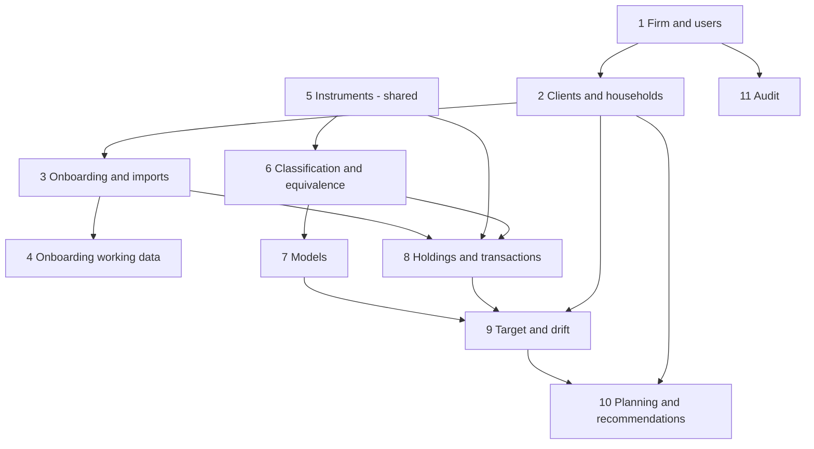

Reading it: instruments and classification feed models; models and holdings meet
at the target, which is where drift is measured; drift feeds planning and
recommendations. Audit observes everything and is referenced by nothing.

---

## 1. Firm and users

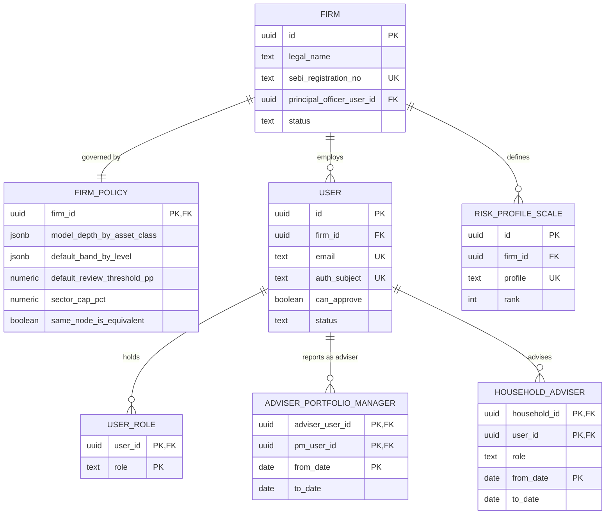

`can_approve` is a flag on the user, not a role — an approver may hold any role.
Exactly one `primary` `HOUSEHOLD_ADVISER` is current per household.

## 2. Clients and households

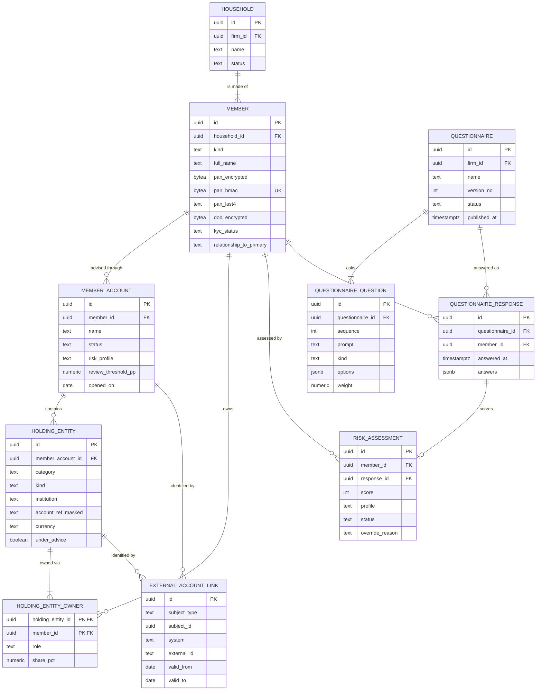

The spine of the whole model. A household has at least one member; a holding
entity has at least one owner; a joint entity belongs to the first holder's
member account, with co-holders recorded in `HOLDING_ENTITY_OWNER` — so drift is
never split or double-counted.

`EXTERNAL_ACCOUNT_LINK` is polymorphic on `subject_type`, which is why it has no
single foreign key and is unique on `(system, external_id)` within validity.

## 3. Onboarding, documents and imports

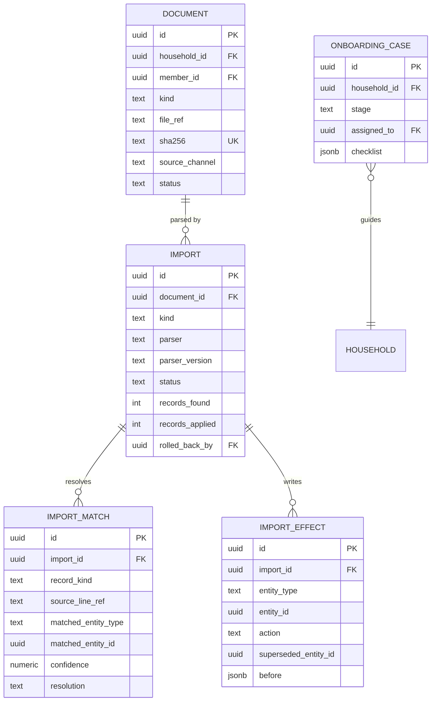

`IMPORT_EFFECT` is the ledger that makes an import reversible. Rollback deletes
the inserts and reopens the rows the import superseded, in reverse order, LIFO
per holding entity.

`IMPORT.document_id` is shown nullable deliberately: Account Aggregator delivers
structured data under a consent artefact rather than a document, and this is
discussion point 7 of `docs/architecture.md`. If that lands the other way, the
column becomes mandatory.

## 4. Onboarding working data

Retained for a period and then discarded; not part of the long-lived portfolio
record.

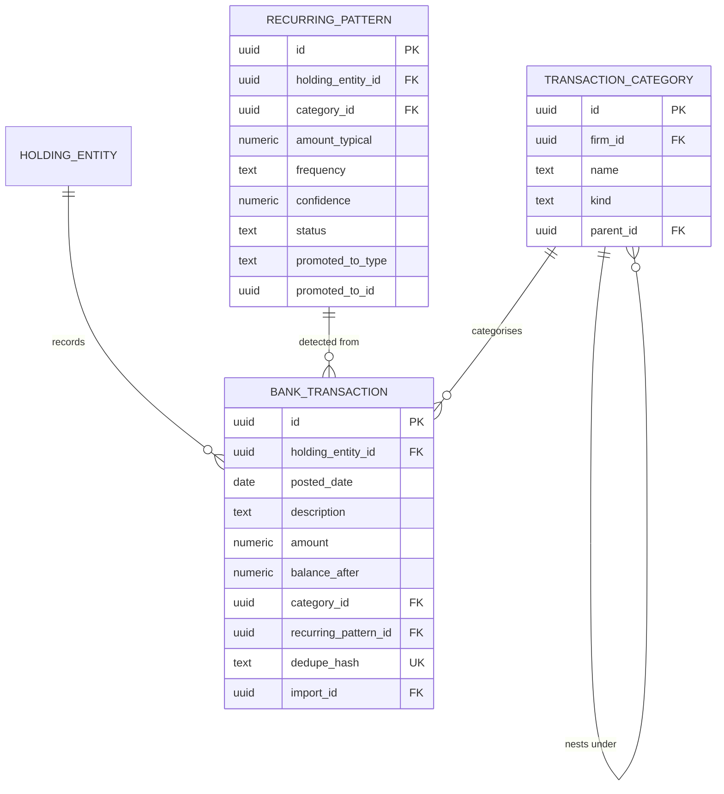

`promoted_to_type` and `promoted_to_id` are a deliberate polymorphic pointer: a
pattern becomes a `LIABILITY`, a `RECURRING_INCOME` or a `RECURRING_NEED`, and
the link is kept so the adviser can see where a figure came from.

## 5. Instruments — mostly shared reference data

**Mostly, not entirely — and the exception matters.** `INSTRUMENT` carries a
`scope` column with nullable `firm_id` and `household_id`, because the data
model took the decision to hold client-specific assets (a particular flat, an
unlisted holding) in the same table as public instruments rather than in a
separate client-asset table.

That decision and schema-per-tenant are in direct tension: a table in the shared
`reference` schema cannot also be partitioned per tenant. Everything else in
this area is genuinely shared and has no tenancy. See section 13.1 and
architecture discussion point 11.

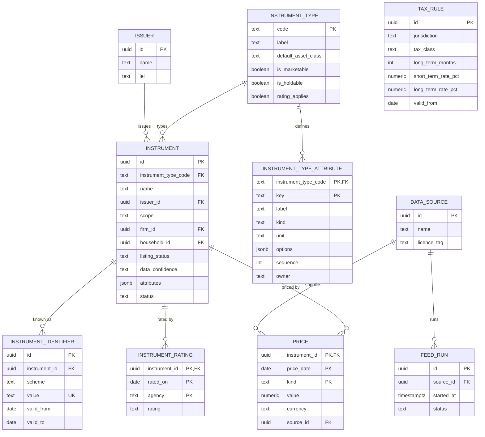

Typed extensions — `MUTUAL_FUND_SCHEME`, `ETF_DETAIL`, `BOND_TERMS`,
`EQUITY_DETAIL`, `REIT_DETAIL`, `NPS_SCHEME`, `ALTERNATIVE_TERMS`,
`FUND_EXPOSURE` — each hang one-to-zero-or-one off `INSTRUMENT`, keyed by
`instrument_id`. They are omitted from the diagram because drawing eight
identical relationships adds nothing; see data model section 3.

`INSTRUMENT.attributes` is a `jsonb` column holding the type-specific fields —
coupon, maturity, expense ratio, purity, rental yield — validated against
`INSTRUMENT_TYPE_ATTRIBUTE`, because the same key means different things on
different types. `owner` on the attribute definition (`feed`, `firm`, `client`)
is what drives the grouped read-only display on security-master row expansion
(feature SM-10).

`PRICE` is a series keyed by date and kind, never a latest-value column on the
instrument. It is the largest table in this area and is range-partitioned by
`price_date`.

## 6. Firm classification and equivalence

Tenant-owned, and the counterpart to area 5: the same public instrument may be
classified differently by two firms.

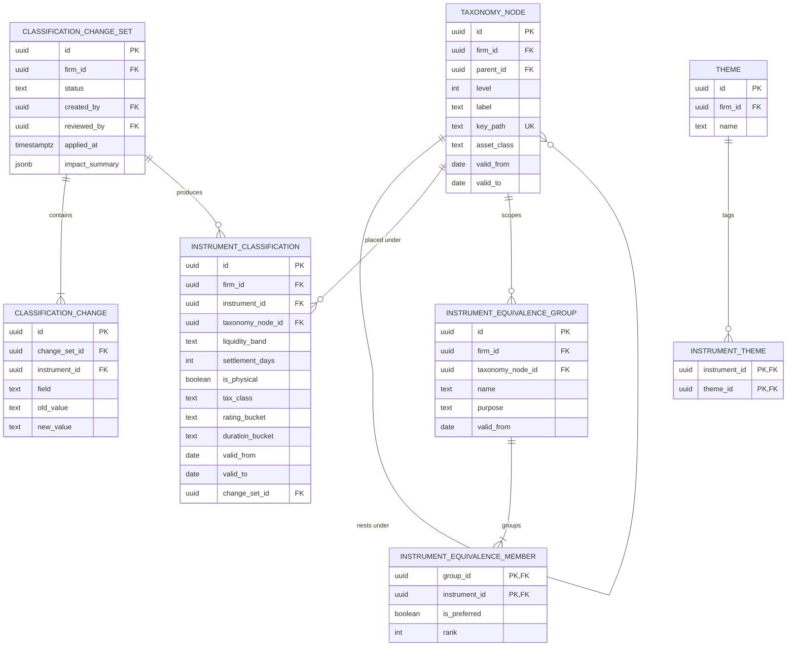

Exactly one current `INSTRUMENT_CLASSIFICATION` per `(firm, instrument)`.
Applying a change set closes the current rows and opens new ones; it never
rewrites an approved target or a stored drift run.

## 7. Models

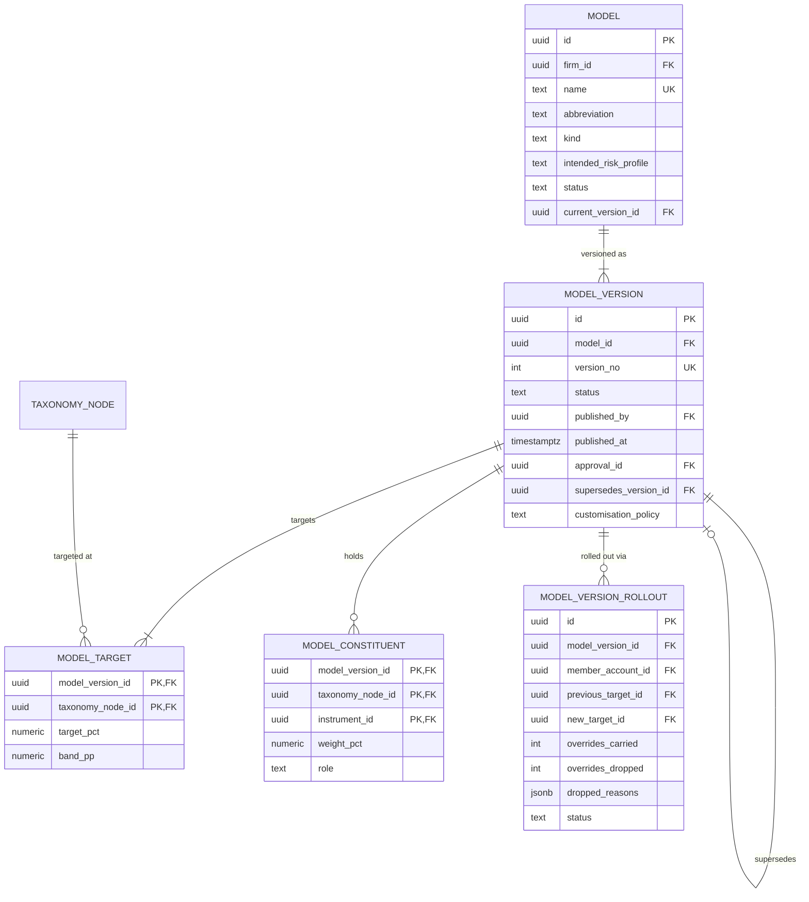

A `MODEL_VERSION` is immutable once published. `MODEL_VERSION_ROLLOUT` carries
one row per member account on the model at publication and is the state machine
for the rollout saga — the version stays `publishing` until every row is
terminal.

## 8. Holdings and transactions

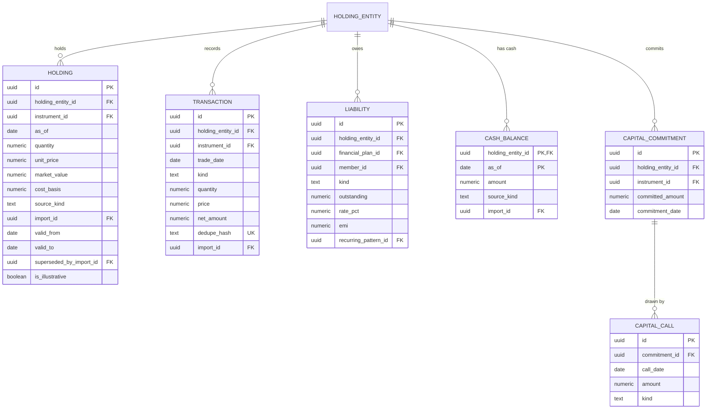

The current position is the `HOLDING` row with a null `valid_to`. Imports
supersede rather than update, so history and rollback fall out of the same rows
rather than needing a separate audit table.

Nothing in this area is written by planning or recommendation workflows:
approving a recommendation never changes a holding.

## 9. Member-account target and drift

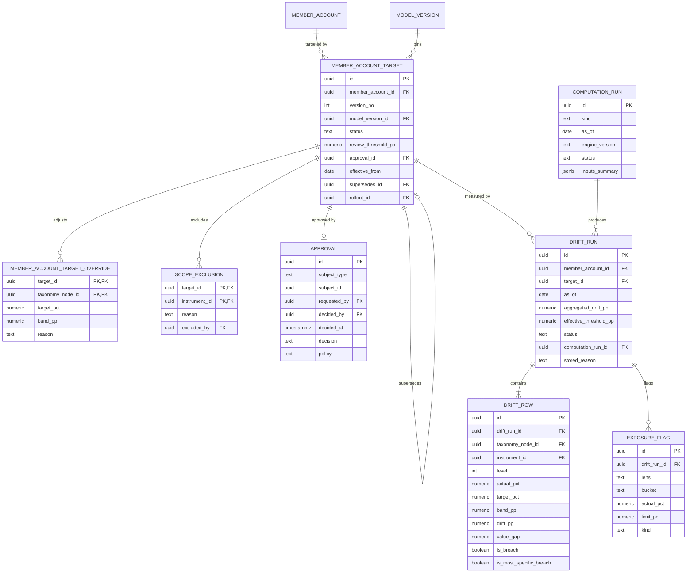

Drift is stored at **member-account level only**. Household and firm views
aggregate stored runs; nothing is computed or approved at household level.

`APPROVAL` is polymorphic on `subject_type` — target, model version,
recommendation, classification change set or financial plan — which is why it
carries no single foreign key.

`DRIFT_ROW` is the fastest-growing table in the system and the subject of
discussion point 4 of `docs/architecture.md`.

## 10. Planning and recommendations

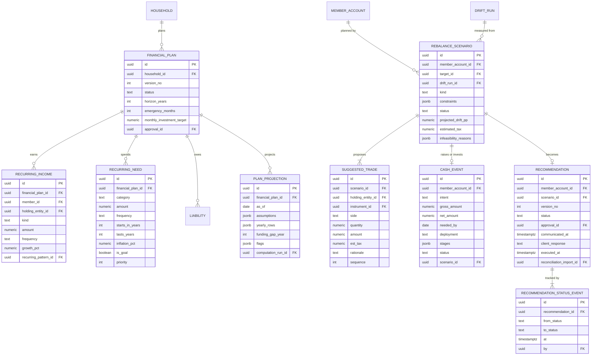

`LIABILITY` appears in both area 8 and area 10: it hangs off a holding entity
where a statement exists and belongs to the household plan for the roll-up. It
is one table with two parents, not two tables.

## 11. Audit

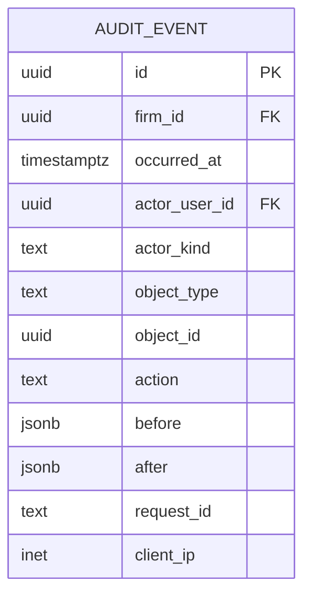

Append-only, with no inbound foreign keys. `object_type` and `object_id` are a
deliberate polymorphic pointer: constraining them would make the audit log
depend on the lifetime of the rows it describes, which defeats its purpose.

---

## 12. Service ownership overlay

The bridge from this document to `docs/microservices-design.md`.

| Area | Owning service | Tenancy |
|---|---|---|
| 1 Firm and users | identity-and-firm | `platform` schema, cross-tenant |
| 2 Clients and households | advisory-core | tenant schema |
| 3 Onboarding, documents and imports | ingestion, except `IMPORT_EFFECT` → advisory-core | tenant schema |
| 4 Onboarding working data | ingestion | tenant schema |
| 5 Instruments | reference-data | `reference` schema, no tenancy |
| 6 Classification and equivalence | advisory-core | tenant schema |
| 7 Models | advisory-core | tenant schema |
| 8 Holdings and transactions | advisory-core | tenant schema |
| 9 Target, approval and drift | advisory-core, except `DRIFT_RUN`, `DRIFT_ROW`, `EXPOSURE_FLAG`, `COMPUTATION_RUN` → analytics | tenant schema |
| 10 Planning and recommendations | advisory-core, except `PLAN_PROJECTION`, `REBALANCE_SCENARIO`, `SUGGESTED_TRADE` → analytics | tenant schema |
| 11 Audit | audit | tenant schema |

Areas 9 and 10 are the only ones that split, and they split along the same line
every time: **what a `COMPUTATION_RUN` produced belongs to analytics; what
carries an `APPROVAL` belongs to advisory-core.**

## 13. Cross-boundary references

Relationships that cross a service or schema boundary. These are where a
foreign key may not be available and where consistency has to be reasoned about
rather than declared.

| From | To | Crosses | Enforceable as FK? | Handling |
|---|---|---|---|---|
| `INSTRUMENT_CLASSIFICATION.instrument_id` | `reference.INSTRUMENT` | tenant → `reference` schema | **Yes** — same database | Declare the FK. Reference data is never deleted, only superseded |
| `HOLDING.instrument_id` | `reference.INSTRUMENT` | tenant → `reference` | **Yes** | Declare the FK |
| `MODEL_CONSTITUENT.instrument_id` | `reference.INSTRUMENT` | tenant → `reference` | **Yes** | Declare the FK |
| `DRIFT_ROW.instrument_id` | `reference.INSTRUMENT` | tenant → `reference` | **Yes** | Declare the FK |
| `USER.firm_id`, `HOUSEHOLD_ADVISER.household_id` | `platform` ↔ tenant | `platform` → tenant schema | **No** — crosses the tenant boundary in the wrong direction | `HOUSEHOLD_ADVISER` lives in `platform` and references a household id without a constraint. Orphan detection is a scheduled integrity job |
| `DRIFT_RUN.target_id` | `MEMBER_ACCOUNT_TARGET` | analytics → advisory-core | **Yes** — same schema | Declare the FK. Both are tenant-schema tables; the service split is logical, not physical |
| `RECOMMENDATION.scenario_id` | `REBALANCE_SCENARIO` | advisory-core → analytics | **Yes** | Declare the FK, and **block deletion of a scenario a recommendation pins** — this is what makes an approved recommendation reproducible |
| `IMPORT_EFFECT.import_id` | `IMPORT` | advisory-core → ingestion | **Yes** | Declare the FK |
| `IMPORT_EFFECT.entity_id` | any superseded row | polymorphic | **No** | By design. Validated by the rollback routine, not by a constraint |
| `APPROVAL.subject_id` | five subject types | polymorphic | **No** | By design |
| `AUDIT_EVENT.object_id` | anything | polymorphic | **No** | By design |
| `EXTERNAL_ACCOUNT_LINK.subject_id` | four subject types | polymorphic | **No** | By design |
| `RECURRING_PATTERN.promoted_to_id` | three target types | polymorphic | **No** | By design |

Two conclusions worth carrying into the microservices design:

- **Most cross-service references are still enforceable**, because the service
  split is logical and the tables share a database. That is a benefit of the
  decomposition in `docs/architecture.md` section 1, and it would be lost by
  splitting the database per service.
- **Six relationships are deliberately polymorphic** and can never have a
  foreign key. Each needs an integrity check in code and a scheduled orphan
  scan. They are not accidents and should not be "fixed".

### 13.1 Scoped instruments versus schema-per-tenant

Drawing area 5 surfaced a conflict between two decisions that were each taken
soundly on their own.

The data model decided: **one `Instrument` table with a scope column, not a
separate client-asset table.** `Instrument` therefore carries `scope` with
nullable `firm_id` and `household_id`, so a client's flat or an unlisted
holding sits beside HDFC Bank in the same table, classified by the same
taxonomy and held by the same `Holding` rows.

The architecture decided: **a schema per tenant, with shared `reference` and
`platform` schemas.**

These cannot both hold. A table in the shared `reference` schema cannot also be
partitioned per tenant, and a tenant's private assets sitting in a shared table
is precisely the isolation property that justified schema-per-tenant.

| Option | Consequence |
|---|---|
| **A. Split the table.** `reference.instrument` for `scope = public`; `tenant_x.instrument` for firm- and household-scoped rows | Contradicts "one table". Every query that joins a holding to an instrument must now resolve across two tables, usually by a view that unions them. `Holding.instrument_id` can no longer carry a single foreign key |
| **B. One table in `reference`**, with `firm_id` and `household_id` populated for scoped rows | Keeps the data model intact and keeps the foreign keys. But tenant-private data lives outside the tenant schema, so `reference` needs row-level security for scoped rows — reintroducing exactly the mechanism schema-per-tenant was chosen to avoid, for one table |
| **C. No client-specific instruments in phase 1.** Public instruments only; defer private assets | Cleanest structurally, but the prototype already shows real assets and liabilities on the balance sheet, so this removes delivered behaviour |

**Recommendation: option B.** It preserves the data model's decision and every
foreign key in section 13, and confines the row-level-security mechanism to a
single, small, well-understood table rather than spreading it across the schema.
The isolation argument is weaker here than it looks, because scoped instrument
rows carry a name and a type — not holdings, values or personal data.

This is new since `docs/architecture.md` revision 1 and is recorded there as
discussion point 11. `ROADMAP.md` already lists "deciding where client-specific
assets live" as unresolved under security-master extensions, so this is a known
gap now given a concrete shape.

## 14. Tenancy and `firm_id`

Under schema-per-tenant, `firm_id` is redundant on tenant-schema tables — the
schema already determines the firm. It is retained anyway:

- A row stays self-describing in a log line, an error report or a support query.
- Consolidating onto a shared schema later becomes a configuration change rather
  than a data migration.
- It costs one column.

`reference` tables have no `firm_id` and must not acquire one. `platform` tables
carry it as a real discriminator, because that schema genuinely is cross-tenant.

This is discussion point 10 of `docs/architecture.md`, and is open.

## Open items

1. **Where scoped instruments live** — section 13.1, and architecture discussion
   point 11. This is the only open item here that blocks a table: the
   `INSTRUMENT` DDL cannot be written until it is settled.
2. **Typed instrument extensions are not drawn** (area 5). Eight identical
   one-to-zero-or-one relationships; add them to the DDL, not the diagram.
   `INSTRUMENT_TYPE_ATTRIBUTE` *is* drawn, because it defines the `jsonb`
   attribute contract rather than being one more extension table.
3. **Deferred research entities are not drawn.** They are in the data model
   appendix and are not built in this phase.
4. **`IMPORT.document_id` nullability** follows architecture discussion point 7.
5. **Partitioning is not shown.** `PRICE`, `BANK_TRANSACTION`, `AUDIT_EVENT` and
   `DRIFT_ROW` are partitioned; that belongs in the DDL.
6. **`HOUSEHOLD_ADVISER` placement** — shown in `platform` with area 1, but it
   references a tenant-schema household. It may belong in the tenant schema
   instead, which would move the unenforceable reference rather than remove it.
   Decide with the DDL.
