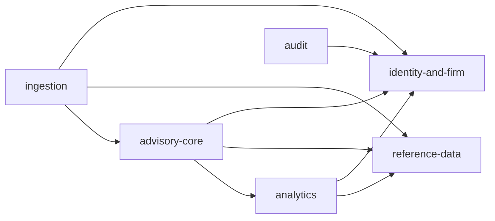

# Microservices design

Status: **revision 1, draft for review**, 31 October 2026.

Dependencies, as specified: `docs/feature-list.md` (revision 1) and
`docs/erd.md` (revision 1). The decomposition itself and its rationale are in
`docs/architecture.md` section 1 and are not restated here; this document is the
design *of* those services — what each one owns, what it exposes, what it
publishes, what it depends on, and what happens when it is not there.

It is also the direct input to the API design, which needs the surface of each
service, and to the batch job design, which needs the event catalogue in
section 4.

## 1. The six services at a glance

| Service | Owns (ERD areas) | Features | Scaling driver |
|---|---|---|---|
| `identity-and-firm` | 1 | FS-01..14 | Request rate; read-heavy and cacheable |
| `reference-data` | 5 | RD-01..12 | Feed volume and instrument count |
| `advisory-core` | 2, 3 (`IMPORT_EFFECT`), 6, 7, 8, 9 (approval-bearing), 10 (approval-bearing) | ON, SM, MD, OV, PD, CT, RC, AL/CP (master data) | Adviser concurrency |
| `analytics` | 9 (computed), 10 (computed) | AD, GT, CP (computed), OV-04/07/08 | Member-account count; nightly batch |
| `ingestion` | 3, 4 | IN-01..19 | Document volume; bursty |
| `audit` | 11 | AU-01..08 | Write rate; query is rare |

## 2. Service designs

### 2.1 identity-and-firm

**Responsibility.** The authorization source of truth, and tenant lifecycle.

**Owns.** `Firm`, `FirmPolicy`, `User`, `UserRole`, `AdviserPortfolioManager`,
`HouseholdAdviser`, `RiskProfileScale`, the tenant registry and the migration
ledger. Lives in the shared `platform` schema.

**Exposes.** Current user and effective permissions; firm policy; user and role
administration; the household-to-adviser assignment graph; tenant provisioning.

**Depends on.** Nothing. It is the root of the dependency graph.

**Consumed by.** Every service, on every request, to resolve the principal into
a firm, a role set and a household scope.

**Design notes.**

- The `GET /me/authorization` response — firm, roles, `can_approve`, household
  scope — is the hottest call in the system. It is cacheable for a short TTL
  with explicit invalidation when `UserRole` or `HouseholdAdviser` changes.
- **Tenant provisioning (FS-02) is a long-running operation**, not a create
  endpoint: create schema, run migrations, seed taxonomy, instrument types,
  transaction categories and the risk scale. It returns `202` with a status
  resource.
- This service must not reach into tenant schemas for business data. It knows
  that household `X` exists and who advises it; it does not know what is in it.

### 2.2 reference-data

**Responsibility.** Everything about an instrument that is true regardless of
which firm holds it.

**Owns.** ERD area 5, in the shared `reference` schema.

**Exposes.** Instrument search and lookup; identifiers; price series; type
master and attribute definitions; ratings; tax rules; feed status.

**Depends on.** Nothing internal. External price and instrument feeds.

**Design notes.**

- **Read-mostly and shared.** `advisory-core` and `analytics` read the
  `reference` schema directly through declared read-only views rather than
  issuing one REST call per holding. The service owns writes, migrations and the
  feed pipeline; it is not a gatekeeper for reads. This is the single biggest
  performance decision in the design — a drift run touching 200 holdings cannot
  afford 200 HTTP calls.
- **`Instrument.scope` is unresolved.** Firm- and household-scoped instrument
  rows conflict with schema-per-tenant; see `docs/erd.md` section 13.1 and
  architecture discussion point 11. Until it is settled, this service's tenancy
  story has an exception in it.
- Prices are never fanned out per tick (architecture section 4.2). The service
  publishes one `prices.updated` per feed run, not per instrument.

### 2.3 advisory-core

**Responsibility.** The transactional and approval heart. Everything a human
decided or edited.

**Owns.** ERD areas 2, 6, 7, 8; the approval-bearing parts of 9 and 10; and
`IMPORT_EFFECT` from area 3.

**Internal modules** (Spring Modulith, boundaries enforced by ArchUnit):

| Module | Owns | Principal features |
|---|---|---|
| `clients` | Household, Member, MemberAccount, HoldingEntity, risk | ON-01..14 |
| `holdings` | Holding, Transaction, Liability, CashBalance, ImportEffect | IN-09, IN-10, IN-16 |
| `taxonomy` | TaxonomyNode, InstrumentClassification, change sets, equivalence | SM-01..16 |
| `models` | Model, ModelVersion, targets, constituents, rollout | MD-01..16 |
| `targets` | MemberAccountTarget, overrides, scope exclusions | CT-01..10 |
| `approvals` | Approval, and the policy that governs it | CT-07, MD-11, RC-01 |
| `plans` | FinancialPlan, RecurringIncome, RecurringNeed | CP-06, CP-10..13 |
| `recommendations` | Recommendation, status events, cash events | RC-01..06 |

**Depends on.** `identity-and-firm` for authorization; `reference-data` for
instrument facts; `analytics` synchronously for on-demand recalculation.

**Design notes.**

- **It never embeds the calculation engine.** When a screen needs a fresh
  figure, it calls `analytics`. One home for the mathematics.
- **The approval boundary is the service boundary.** A row that carries an
  `Approval` is core; a row a `ComputationRun` produced is analytics.
- **Import apply (IN-09) is the one write that spans services.** `ingestion`
  stages; core applies. It is a single transaction writing holdings, holding
  entities, external links and `ImportEffect` together, because a half-applied
  import is not reversible.
- Rollback (IN-10) is LIFO per holding entity and refuses when a later import
  has superseded the same rows.

### 2.4 analytics

**Responsibility.** Everything a `ComputationRun` produced and can rebuild.

**Owns.** `ComputationRun`, `DriftRun`, `DriftRow`, `ExposureFlag`,
`PlanProjection`, `RebalanceScenario`, `SuggestedTrade`.

**Exposes.** Drift for a member account, current or historical; household
aggregation over stored member-account runs; plan projections; scenario
construction and evaluation; exposure flags.

**Depends on.** `advisory-core` data (same schema, read via views);
`reference-data` for prices and classifications.

**Design notes.**

- **Houses the engine library** — pure Java, no I/O — and is the only service
  that runs it. The same library serves the synchronous recalculation endpoint
  and the nightly workers, so a figure cannot differ by code path.
- **Everything it owns is deletable.** The entire schema can be dropped and
  rebuilt from master data. That is the test for whether a table belongs here.
- **Household figures are aggregations of stored member-account runs** (PD-02).
  Nothing is computed or approved at household level.
- **A scenario pinned by a recommendation cannot be deleted** (ERD section 13).
  This is the one exception to "everything here is disposable", and it is what
  makes an approved recommendation reproducible.
- Split into an API deployment and a worker deployment sharing one image. The
  API serves advisers; the workers serve the queue. They scale on different
  signals and must not compete for the same pods.

### 2.5 ingestion

**Responsibility.** Turning documents into reviewed, structured data. The only
service that handles raw client PII documents.

**Owns.** ERD areas 3 (except `IMPORT_EFFECT`) and 4.

**Exposes.** Document upload and retrieval; import lifecycle; the review queue
and match resolution; recurring-pattern detection and promotion; transaction
categories.

**Depends on.** Blob Storage; `reference-data` for instrument matching;
`advisory-core` to apply a reviewed import.

**Design notes.**

- **It parses and stages; it does not write holdings.** The seam is
  deliberate — see architecture section 1.3.
- **Parsers are versioned and pluggable** (`Import.parser`,
  `parser_version`). A document can be re-imported with a newer parser and every
  run is kept, so improving a parser does not require re-uploading statements.
- **The parser may not be Java.** Architecture discussion point 6: the mature
  PDF tooling is in Python, and this service's boundary is clean enough to make
  a polyglot parser worker tolerable. If that lands, the parser is a separate
  deployment behind the same service API.
- **Statement passwords are credentials.** NSDL and CDSL CAS files are
  protected by a PAN and date-of-birth derivation. Used transiently at parse
  time, never stored with the document.
- Bursty by nature: ten documents one day, four hundred during an onboarding
  push. KEDA-scaled, with per-document jobs rather than a fixed worker pool.

### 2.6 audit

**Responsibility.** The append-only record, its retention and its query surface.

**Owns.** `AuditEvent`.

**The write path is deliberately not a service call.**

> An audit entry that can be lost because a message failed is not an audit
> trail.

Business services write `AuditEvent` rows **through a shared library, in the
same database transaction as the change being recorded**. The entry and the
change commit together or not at all. The `audit` service owns the table, its
partitioning, its retention policy and the read API — it is not in the write
path.

This is the one place the design deliberately trades service purity for a
correctness property that the regulator cares about. Asynchronous audit via
Service Bus would be cleaner and would be wrong.

**Exposes.** The filtered audit feed (AU-01..03) and before/after detail.

## 3. Dependency graph

**Acyclic, and it must stay that way.** The one edge that looks like a cycle —
`advisory-core → analytics` for on-demand recalculation — is not, because
`analytics` never calls `advisory-core` synchronously. It reads what it needs
and reports completion by event. An ArchUnit rule and a CI check on the
dependency declaration enforce this.

### Synchronous call matrix

| Caller ↓ / Callee → | identity-and-firm | reference-data | advisory-core | analytics | ingestion | audit |
|---|---|---|---|---|---|---|
| **identity-and-firm** | — | no | no | no | no | no |
| **reference-data** | no | — | no | no | no | no |
| **advisory-core** | yes | yes | — | yes | no | no |
| **analytics** | yes | yes | **no** | — | no | no |
| **ingestion** | yes | yes | yes | no | — | no |
| **audit** | yes | no | no | no | no | — |

## 4. Event catalogue

Every event carries `event_id`, `firm_id`, `occurred_at`, `request_id` for
correlation, and a `schema_version`. Consumers are idempotent on `event_id`
(architecture section 4.1).

| Event | Published by | Consumed by | Carries | Triggers |
|---|---|---|---|---|
| `document.uploaded` | ingestion | ingestion workers | `document_id`, `kind` | Parse job |
| `import.parsed` | ingestion | — (UI polls) | `import_id`, counts | Review queue entry |
| `import.applied` | advisory-core | analytics, audit | `import_id`, affected `member_account_id[]` | Drift recompute |
| `import.rolled_back` | advisory-core | analytics, audit | `import_id`, affected accounts | Drift recompute |
| `holdings.changed` | advisory-core | analytics | `member_account_id` | Drift recompute |
| `target.approved` | advisory-core | analytics, audit | `target_id`, `member_account_id` | Drift recompute |
| `model.published` | advisory-core | advisory-core rollout workers, audit | `model_version_id`, `customisation_policy` | Rollout saga |
| `rollout.account` | advisory-core | advisory-core rollout workers | `rollout_id`, `member_account_id` | One account rolled forward |
| `model.rollout.completed` | advisory-core | analytics, audit | `model_version_id` | Version becomes `published` |
| `classification.applied` | advisory-core | analytics, audit | `change_set_id`, affected accounts | Drift recompute |
| `plan.changed` | advisory-core | analytics | `financial_plan_id` | Projection rebuild |
| `prices.updated` | reference-data | analytics | `feed_run_id`, `as_of` | **Nothing immediately** — the nightly run picks it up |
| `drift.compute` | analytics scheduler | analytics workers | `member_account_id`, `as_of` | One drift run |
| `drift.run.completed` | analytics | — (UI polls) | `drift_run_id`, `status` | — |
| `projection.compute` | analytics scheduler | analytics workers | `financial_plan_id` | One projection |
| `recommendation.status.changed` | advisory-core | audit | `recommendation_id`, from, to | — |

`prices.updated` deliberately triggers nothing. Fanning drift out on every price
feed would recompute every account in the system daily at an arbitrary moment;
the nightly run already does that at a chosen one.

## 5. Failure and degradation

What still works when a service is down. This matters more than usual here
because **the services share one database**: a service being unavailable does
not make its data unavailable to a reader using a declared view.

| Down | Still works | Breaks |
|---|---|---|
| `identity-and-firm` | Nothing new; cached authorization lets in-flight sessions continue for the cache TTL | All authorization resolution. **The hardest single point of failure** — mitigate with cache and at least two replicas |
| `reference-data` | All reads that go through `reference` views: portfolios, drift display, models. Price ingestion queues | Instrument search, new feed runs, tax-rule administration |
| `advisory-core` | Audit queries; stored analytics reads | Most of the product |
| `analytics` | Every stored figure still renders — drift, projections, past scenarios | New drift runs, new scenarios, the nightly batch (it backs up on the queue and drains) |
| `ingestion` | Everything except documents | Upload, parsing, the review queue. Applied data is unaffected |
| `audit` | **All business writes, because the write path is a library** | Audit queries only |

Two deliberate consequences:

- **An audit outage never blocks business operations**, and never loses an
  entry, because the write is in the business transaction.
- **An analytics outage degrades to stale figures rather than to errors.**
  Screens show the last stored run with its `as_of` date, which is the honest
  behaviour and is already how the prototype presents dated data.

## 6. Shared service template

Every service is built from one template so that cross-cutting behaviour is
identical and is fixed in one place:

- Java 25, Spring Boot 4.x, virtual threads enabled.
- Tenant resolution filter: principal → firm → `search_path`, immutable for the
  request, reset on connection release (architecture section 3.3).
- JWT validation independent of API Management.
- `request_id` generated or propagated, placed in the logging context, attached
  to every outbound call and every published event.
- Transactional outbox and `processed_message` tables, with the relay.
- OpenTelemetry auto-instrumentation; structured JSON logs with PII redaction.
- Liveness, readiness and startup probes. Readiness fails while migrations for
  the tenant set are incomplete.
- Health check that does **not** check downstream services — cascading readiness
  failures turn one outage into six.

## 7. Deployment shape

Indicative only; sizing belongs in `docs/infrastructure.md`.

| Service | Deployments | Scaling signal |
|---|---|---|
| `identity-and-firm` | api | CPU, request rate. Minimum two replicas |
| `reference-data` | api, feed-worker | CPU; queue depth for the worker |
| `advisory-core` | api, rollout-worker | CPU; queue depth for the worker |
| `analytics` | api, compute-worker | CPU for the API; **KEDA on queue depth** for the worker |
| `ingestion` | api, parse-worker (Jobs) | **KEDA on queue depth**; per-document Jobs |
| `audit` | api | Low and flat |

Migrations run as a separate AKS Job, not on pod startup (architecture
section 3.4).

## Decisions taken

- **Audit is written in-transaction through a library, not by message.** The
  service owns the table, the retention and the query API, not the write path.
- **`analytics` never calls `advisory-core` synchronously**, which is what keeps
  the dependency graph acyclic.
- **Cross-service reads go through declared database views, not REST**, because
  the services share a database and a drift run cannot afford per-holding HTTP.
- **`analytics` and `ingestion` each split into an API deployment and a worker
  deployment** sharing one image, because they scale on different signals.
- **`prices.updated` triggers no immediate recomputation.**
- **Health checks do not probe downstream services.**
- **A scenario pinned by a recommendation is undeletable**, the one exception to
  analytics being disposable.

## Open items

1. **`Instrument.scope` under schema-per-tenant** — architecture discussion
   point 11. Changes `reference-data`'s tenancy story and possibly its schema.
2. **Whether the parser worker is Java or Python** — architecture discussion
   point 6. Changes `ingestion`'s deployment shape, not its API.
3. **Authorization cache TTL and invalidation.** The trade-off is how long a
   revoked permission remains effective. Needs a number, and it is a compliance
   question as much as a technical one.
4. **Whether `HouseholdAdviser` lives in `platform` or the tenant schema** —
   ERD open item 6. It decides whether `identity-and-firm` can answer "which
   households?" alone, or must ask `advisory-core`.
5. **Import apply for very large statements.** Specified as one transaction;
   a CAS with thousands of lines may need chunking, which would weaken the
   all-or-nothing property. Measure before deciding.
6. **No service owns client reporting or firm-level dashboards** — feature list
   open items 4 and 5. Both are expected and neither has a home.
